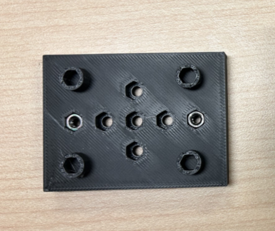
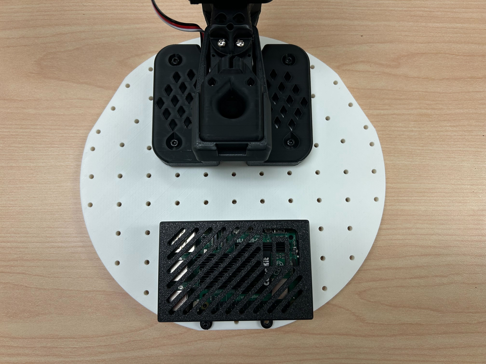
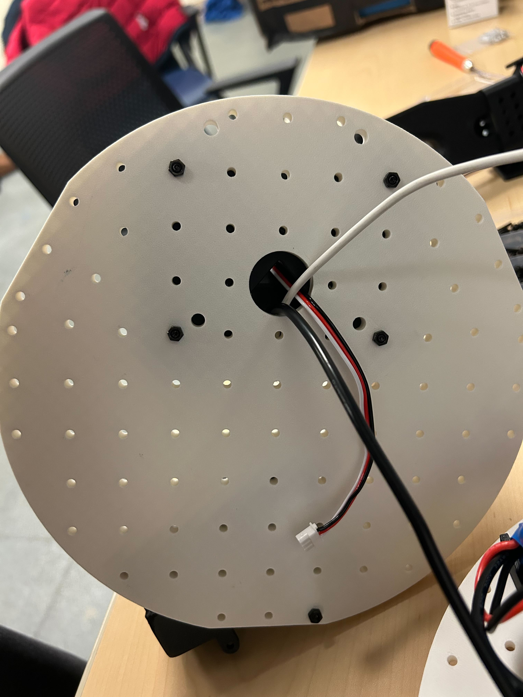
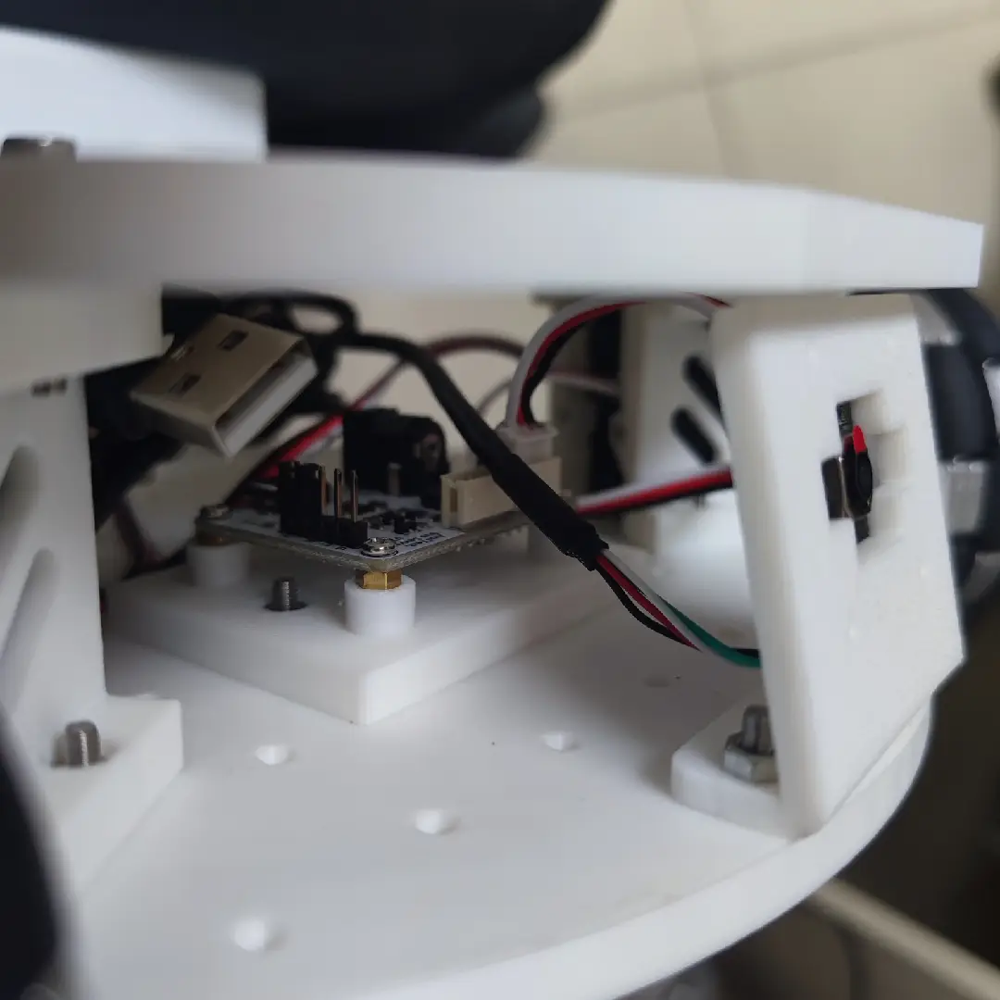
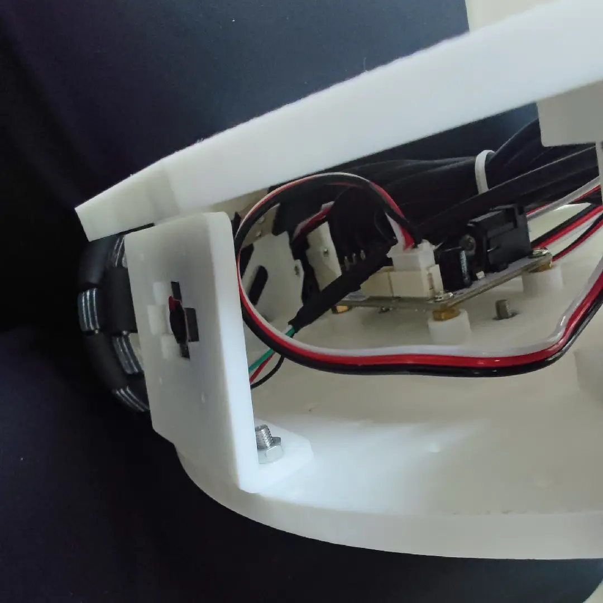
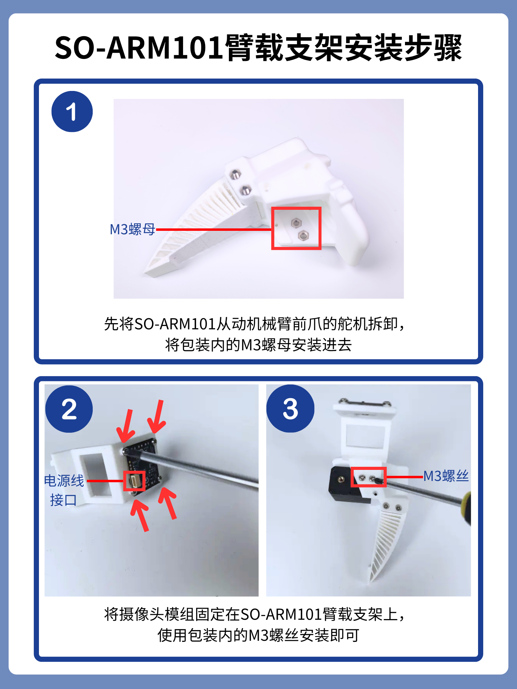
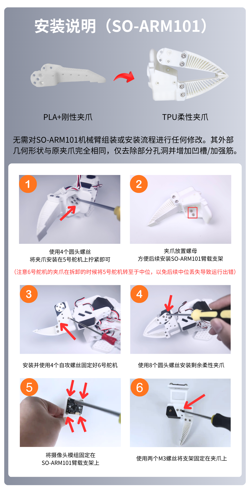
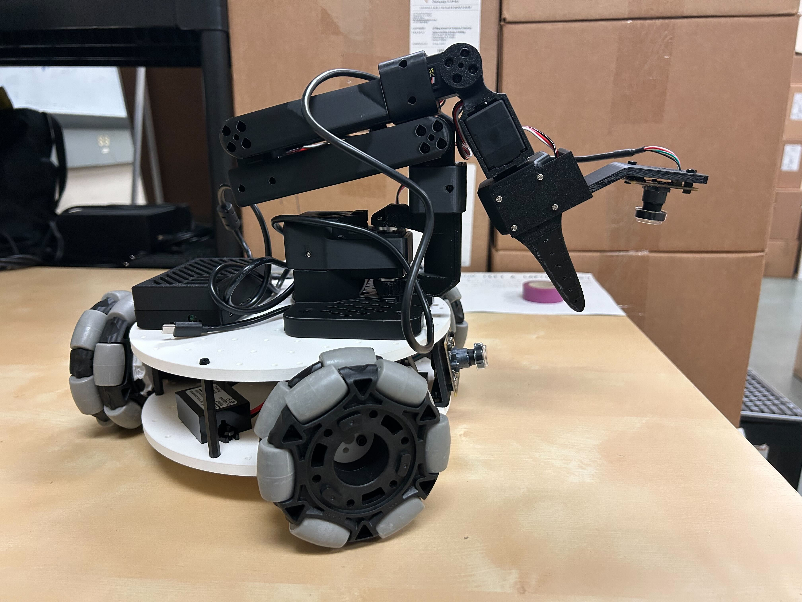

[English](../en/assembly-guide.md) | [简体中文](../zh-hans/assembly-guide.md) | [繁體中文](../zh-hant/assembly-guide.md) | [Deutsch](../de/assembly-guide.md) | [Español](../es/assembly-guide.md) | Français | [Italiano](../it/assembly-guide.md) | [日本語](../ja/assembly-guide.md) | [한국어](../ko/assembly-guide.md) | [Português (BR)](../pt-br/assembly-guide.md) | [Português (PT)](../pt-pt/assembly-guide.md)

<title>Guide d'assemblage du robot mobile Lekiwi</title>

[*Dans le CAO en ligne Fusion360*](https://a360.co/4k1P8yO)*, vous pouvez visualiser la position exacte des composants.*

[Fichier URDF](https://gitcode.com/gh_mirrors/le/LeKiwi/tree/main)

Aperçu URDF en ligne https://urdf.d-robotics.cc/

# 1. Assemblage des modules de roue (3 par robot)

1. Utilisez 12 vis autotaraudeuses **M2x6** pour fixer le moteur d'entraînement au support moteur. (Fournies avec la boîte du servo.)

<grid>
<column width-ratio="0.418383">
![Image montrant le matériel nécessaire à l'assemblage de la plaque de base lors du montage du robot mobile Lekiwi : deux supports de plaque de base en plastique blanc, un moteur d'entraînement noir et un sachet en plastique transparent contenant plusieurs écrous et vis M3. Ce sont les pièces nécessaires à l'étape suivante, celle de l'insertion des écrous M3 dans les trous de la carte de commande de servo et du support de batterie. L'image correspond à la section « 2. Assemblage de la plaque de base » et montre le matériel d'assemblage requis comme référence pour les étapes suivantes.](../en/images/d02-01.png)
</column>
<column width-ratio="0.581617">
![Image de l'assemblage de la plaque de base du robot mobile Lekiwi. La plaque de base est blanche, avec quatre cartes de commande de servo noires au centre, chacune avec des écrous M3 en dessous. De part et d'autre de la plaque de base se trouve un support de batterie noir contenant un connecteur de batterie. L'image correspond à la section « 2. Assemblage de la plaque de base » et montre la structure de l'ensemble de la plaque de base comme référence pour l'insertion des écrous M3 et les étapes suivantes.](../en/images/d02-02.png)
</column>
</grid>

2. Utilisez 12 vis métalliques **M3x16** et 12 **écrous M3** pour fixer les servos à la plaque de base à l'aide des supports de moteur d'entraînement.

3. Retirez les vis métalliques et les écrous des roues omnidirectionnelles de 82 mm.

4. Utilisez des vis m3\*6 pour fixer le palonnier au servo.

5. Installez 4 écrous frein dans l'accouplement. Commencez par utiliser 4 vis m3\*6 pour fixer l'accouplement au palonnier du servo.

<grid>
<column width-ratio="0.476318">
![Image montrant le matériel d'installation pour l'assemblage de la plaque de base dans le guide d'assemblage du robot mobile Lekiwi : une plaque de base en plastique blanc percée de nombreux trous, et deux écrous M3 noirs placés à côté. Ce matériel sert à insérer les écrous M3 dans les trous de la carte de commande de servo et du support de batterie ; il s'agit de pièces clés pour l'assemblage suivant de la plaque de base. L'image se rapporte à la section « 2. Assemblage de la plaque de base » et montre l'aspect et la quantité du matériel requis.](../en/images/d02-06.png)
</column>
<column width-ratio="0.523682">

</column>
</grid>

6. Utilisez des vis métalliques m3\*25 et des écrous frein pour fixer les roues omnidirectionnelles de 82 mm à l'accouplement.

Une fois les trois roues installées sur la plaque de base :

<grid>
<column width-ratio="0.501676">

</column>
<column width-ratio="0.498324">
![Image montrant le résultat de l'assemblage de la plaque de base du robot mobile Lekiwi. La plaque de base est circulaire et densément percée de trous ; trois roues omnidirectionnelles de 82 mm sont montées en dessous, chacune étant constituée d'un corps de roue noir et d'un cadre de roue gris tenant un galet noir. Les roues sont fixées à la plaque par des vis et comportent un petit trou en dessous. L'image correspond au contenu relatif à l'installation des trois roues sur la plaque de base et montre l'état obtenu une fois les roues installées.](../en/images/d02-09.jpg)
</column>
</grid>

![Image montrant l'assemblage de la plaque de base du robot mobile Lekiwi vu de dessus. La plaque de base comporte quatre roues omnidirectionnelles de 82 mm, étiquetées ID = 7 (gauche), ID = 8 (arrière) et ID = 9 (droite). Au centre de la plaque se trouvent la carte de commande de servo et le support de batterie, avec des écrous M3 insérés dans leurs trous. L'image correspond à la section « Assemblage de la plaque de base » et montre la disposition de l'ensemble de la plaque de base comme référence pour les étapes suivantes.](../en/images/d02-10.png)

# 2. Assemblage de la plaque de base

1. Insérez 2 écrous M3 dans les trous de la carte de commande de servo et du support de batterie. Utilisez 4 vis à tête hexagonale M3x12 pour fixer l'ensemble à la plaque de base.

<grid>
<column width-ratio="0.478600">

</column>
<column width-ratio="0.521400">
![Image montrant une partie de l'assemblage du robot mobile Lekiwi. Sur un châssis circulaire blanc se trouvent deux roues avant et une roue arrière, toutes des roues noires à bandage caoutchouc gris, leurs positions étant indiquées par du texte rouge. On distingue également des pièces de fixation noires sur le châssis, dont une pièce carrée noire percée de trous et une pièce rectangulaire noire plus grande. L'image se rapporte au guide d'assemblage du robot mobile et montre la disposition du châssis et des roues.](../en/images/d02-12.png)
</column>
</grid>

2. Utilisez 2 vis à tête hexagonale M3\*12 et 2 écrous M3 pour installer la carte de commande de servo et la relier aux 3 servos.

![Image montrant l'assemblage du robot mobile Lekiwi. Trois roues grises sont montées sur la base circulaire blanche, chacune reliée à une carte de commande de servo noire par des fils rouges et noirs. Une batterie portable noire se trouve au centre de la base, avec des fils connectés en dessous. L'image correspond au contenu relatif à l'installation de la carte de commande de servo avec quatre entretoises M2.5*6.5 et quatre vis M2.5*8 et à sa connexion aux 3 servos, ainsi qu'aux connexions des câbles d'alimentation.](../en/images/d02-13.png)

Connexions des câbles de la batterie portable

- L'**entrée d'alimentation** se connecte directement à l'alimentation

<grid>
<column width-ratio="0.500000">

</column>
<column width-ratio="0.500000">
![Image montrant les connexions d'alimentation du robot mobile Lekiwi. Une batterie lithium de sécurité 12V se trouve en haut, avec le Raspberry Pi en dessous, relié à un câble d'alimentation USB-C. Un voyant rouge est allumé sur le côté droit du Raspberry Pi, à côté de la carte de commande de servo sur laquelle est branché un câble d'alimentation noir. L'image correspond à la section « connexions des câbles de la batterie portable » et montre l'entrée d'alimentation connectée directement à l'alimentation ainsi que l'interface USB-C fournissant 5V au Raspberry Pi.](../en/images/d02-15.png)
</column>
</grid>

- L'interface **USB-C** fournit une alimentation 5V au Raspberry Pi
- Si vous utilisez un **bras robotisé 12V**, alimentez la **carte de commande des servos** directement avec le **répartiteur d'alimentation DC**

<grid>
<column width-ratio="0.500000">
![Image montrant les composants liés à l'alimentation du robot mobile Lekiwi. À gauche se trouve une batterie bleue à étiquette jaune, reliée à des fils noirs et rouges terminés par des fiches noires. À droite se trouve un répartiteur d'alimentation noir à étiquette blanche, également relié à un fil noir terminé par une fiche noire. L'image correspond à la section « connexions des câbles de la batterie portable » et montre l'entrée d'alimentation, l'interface USB-C qui fournit 5V au Raspberry Pi, et le répartiteur d'alimentation DC capable d'alimenter la carte de commande des servos lorsqu'un bras robotisé 12V est utilisé.](../en/images/d02-16.png)
</column>
<column width-ratio="0.500000">
![Image montrant l'assemblage du robot mobile Lekiwi. Quatre roues grises sont montées sur la base circulaire blanche, chacune accompagnée d'une batterie noire. Une carte électronique noire se trouve au centre, reliée à des fils rouges et noirs, et une carte de commande de servo noire est montée en bas. L'image correspond à la section « connexions des câbles de la batterie portable » et montre l'entrée d'alimentation, l'interface USB-C fournissant 5V au Raspberry Pi, et le répartiteur d'alimentation DC alimentant la carte de commande des servos pour un bras robotisé 12V.](../en/images/d02-17.png)
</column>
</grid>

Les câbles peuvent être connectés comme illustré sur la figure ci-dessous :

![Image montrant le schéma de connexion d'alimentation 5V du robot mobile Lekiwi. En haut, la mention « version 5V » indique que l'interface USB-C fournit une alimentation 5V au Raspberry Pi via un câble SH-CP05A. En dessous figurent la carte de commande des servos 7,4V avec une interface DC5.5*2.1, et l'entrée d'alimentation DC 55*25 avec un câble noir. La figure correspond à la section « connexions des câbles de la batterie portable » et montre comment l'entrée d'alimentation, l'interface USB-C et l'interface DC5.5*2.1 sont connectées.](../en/images/d02-18.png)

# 3. Assemblage de la plaque supérieure

1. Placez le Raspberry Pi 5 au fond du boîtier du Raspberry Pi, puis clipsez le couvercle du boîtier.

2. Utilisez deux vis à tête hexagonale M3x16 et deux écrous M3 pour fixer le Raspberry Pi à la plaque de base supérieure, et utilisez quatre vis métalliques M4x25 et quatre écrous M4 pour installer la base du bras robotisé SO-101.

# 4.

1. Faites passer le câble USB-C vers USB-A de la carte de commande de servo, le câble d'alimentation USB-C 5V et les câbles des servos à travers les trous de la plaque supérieure.

2. Utilisez 8 vis métalliques m3x16 et 4 écrous m3 pour installer la plaque supérieure sur les supports moteur.

![Image montrant le robot mobile Lekiwi après assemblage. Le robot possède une plaque de base blanche équipée de quatre roues grises à moyeux noirs. Un bras robotisé noir est monté sur le dessus, relié par des fils rouges et noirs. À droite se trouve une carte de commande de servo noire avec des ports USB sur sa face. L'image correspond au contenu relatif au passage du câble USB-C vers USB-A de la carte de commande de servo, du câble d'alimentation USB-C 5V et des câbles des servos SO0-101 à travers les trous de la plaque supérieure, à l'installation de la plaque supérieure sur les supports moteur avec 6 vis métalliques m3x12 et 6 écrous frein m3, et à la liaison des plaques supérieure et inférieure avec 6 entretoises M3*50 et 6 vis métalliques M3*, montrant l'aspect du robot une fois l'assemblage terminé.](../en/images/d02-21.png)

# 5. Installation des caméras

*Remarque : le support que nous avons conçu est adapté à la caméra que nous avons sélectionnée. D'autres modules de caméra peuvent nécessiter des modifications.*

## (Option 1) Installation de la caméra frontale

①Utilisez 4 vis entretoises m2\*5\*5 pour fixer le module de caméra

②Utilisez 2 vis métalliques m3\*12 et 2 écrous m3 pour installer le support de la caméra frontale sur la plaque de base

<grid>
<column width-ratio="0.500000">

</column>
<column width-ratio="0.500000">

</column>
</grid>

## (Option 2) Installation de la caméra montée sur le bras

Utilisez 4 vis entretoises m2\*5\*5 pour fixer le module de caméra

Ce support accepte les caméras dont l'entraxe des trous est de 24\*25mm ou 28\*28mm

# 6. Branchement de l'alimentation et câblage

Branchez l'adaptateur de fiche DC sur la **carte de commande de servo** ;

Branchez le connecteur USB-C 5V sur le **Raspberry Pi 5** pour alimenter l'électronique ;

Les câbles de données USB de la carte de commande de servo et des caméras peuvent être branchés directement sur le Raspberry Pi.

