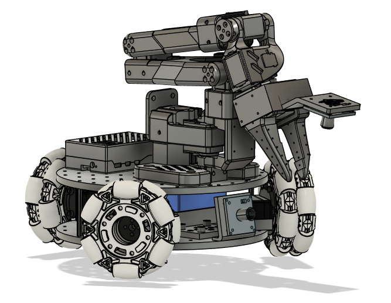
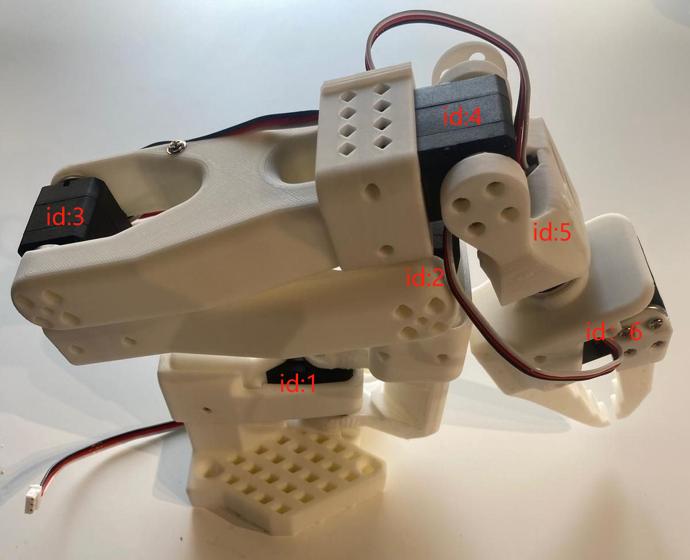
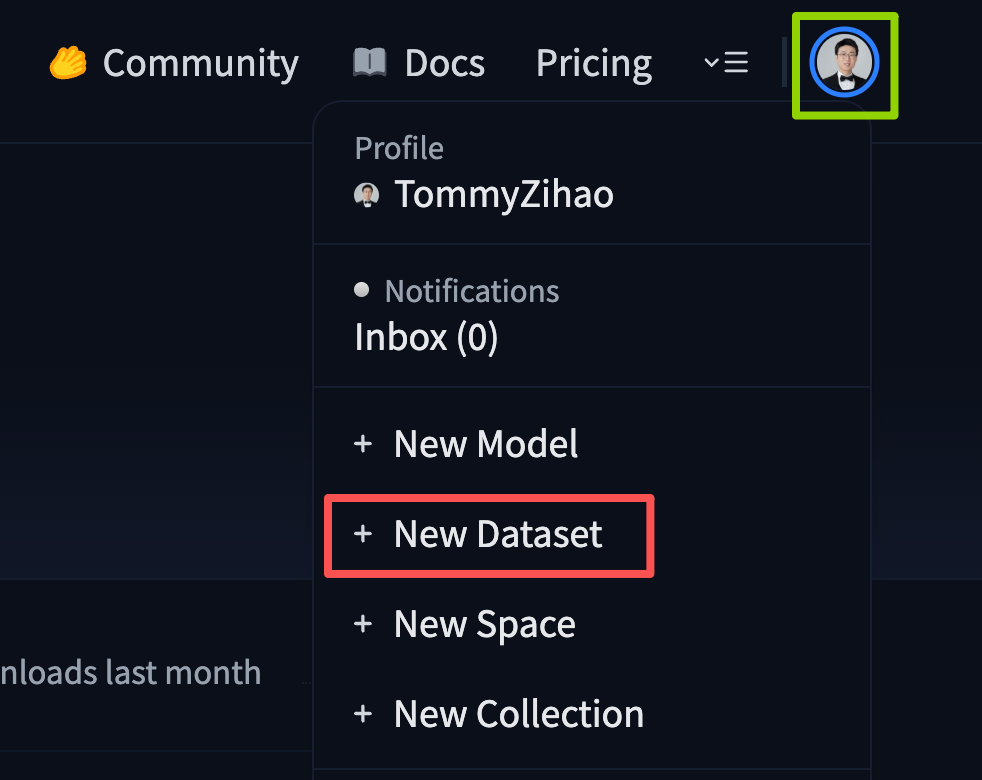

[English](../en/usage-guide.md) | [简体中文](../zh-hans/usage-guide.md) | [繁體中文](../zh-hant/usage-guide.md) | [Deutsch](../de/usage-guide.md) | [Español](../es/usage-guide.md) | [Français](../fr/usage-guide.md) | [Italiano](../it/usage-guide.md) | 日本語 | [한국어](../ko/usage-guide.md) | [Português (BR)](../pt-br/usage-guide.md) | [Português (PT)](../pt-pt/usage-guide.md)

<title>Lekiwi 移動ロボット 使用ガイド</title>

<callout emoji="💡">
黒いリーダーアームは5V 6A電源アダプターを、白いフォロワーアームは12V 5A電源アダプターを使用します。
</callout>

<figure view-type="Card">[添付ファイル: lerobot.zip](../en/images/lerobot.zip)</figure>

このチュートリアルリポジトリのコードは、2026年10月1日より前の LeRobot のテスト済み安定版に保たれています。その後 Hugging Face は LeRobot に非常に大規模なアップグレードを実施し、多数の新機能を追加しました。最新のチュートリアルをお試しになりたい場合は、[公式ドキュメント](https://huggingface.co/docs/lerobot/lekiwi)に従ってください。


[Lekiwi](https://github.com/SIGRobotics-UIUC/LeKiwi) は、[SIGRobotics-UIUC](https://github.com/SIGRobotics-UIUC) が発起した完全オープンソースのロボットカー プロジェクトです。詳細な3Dプリントファイルと操作手順を含み、[LeRobot](https://github.com/huggingface/lerobot/tree/main) 模倣学習フレームワークと互換になるよう設計されています。SO101 ロボットアームをサポートし、完全な模倣学習ワークフローを実現できます。

[*Fusion360 のオンライン CAD*](https://a360.co/4k1P8yO)* で、各部品の正確な位置を確認できます。*

[URDF ファイル](https://gitcode.com/gh_mirrors/le/LeKiwi/tree/main)

オンライン URDF プレビュー https://urdf.d-robotics.cc/



## 主な特徴

1. **オープンソースで低コスト**: [Lekiwi](https://github.com/SIGRobotics-UIUC/LeKiwi) は、オープンソースで低コストなロボットカー ソリューションを提供します。
2. **LeRobot との統合**: [LeRobot プラットフォーム](https://github.com/huggingface/lerobot)との統合を目的として設計されています。
3. **充実した学習リソース**: 組み立てガイドとキャリブレーションガイドに加え、テスト、データ収集、学習、デプロイのチュートリアルを含む包括的なオープンソースの学習リソースを提供し、ユーザーがすぐに始めてロボットアプリケーションを構築できるよう支援します。
4. **Nvidia 対応**: reComputer Mini J4012 Orin NX 16 GB で使用できます。
5. **多様なシーンでの応用**: 教育、科学研究、自動化生産、ロボティクスに適しており、さまざまな複雑なタスクにおいて、効率的で高精度なロボット運用の実現を支援します。

<callout emoji="⚠️">
JUXI はハードウェア自体の品質にのみ責任を負います。本チュートリアルは公式ドキュメントに厳密に沿って更新されています。ソフトウェアや環境依存の問題でどうしても解決できない場合は、速やかに [LeRobot プラットフォーム](https://github.com/huggingface/lerobot)または [LeRobot Discord チャンネル](https://discord.gg/8TnwDdjFGU)へ報告してください。
</callout>

<callout emoji="🔥">
**注意**
- Lekiwi シャーシのすべてのサーボは12V電源が必要です。5V ロボットアームをお使いの方向けに、12V→5V 降圧コンバーターモジュールをご用意しています。なお、配線はご自身で変更していただく必要があります。
- 12V 電源 – 必要に応じてご注文時にこのオプションを選択できます。すでに12V電源をお持ちの場合は、その電源出力コネクタを 5521 DC プラグに変換するだけで済みます。
- Raspberry Pi コントローラとカメラ – これらは注文ページから別途ご購入いただく必要があります。
</callout>

## 部品表(BOM)

<sheet sheet-id="MNu6oT" token="Z4UGs2S65hWsWBtzlT8c80yCnqc"></sheet>

## 初期システム環境

**Ubuntu x86 の場合:**

- Ubuntu 22.04
- CUDA 12+
- Python 3.10
- Torch 2.6

**Jetson Orin の場合:**

- Jetson JetPack 6.0
- Python 3.10
- Torch 2.3+

**Raspberry Pi の場合:**

- Raspberry Pi 5、4G\~16G

### SSH の設定

Raspberry Pi をセットアップしたら、[SSH](https://www.raspberrypi.com/news/coding-on-raspberry-pi-remotely-with-visual-studio-code/)(Secure Shell)を有効化して設定しておくと、Pi にモニター、キーボード、マウスを接続することなく、ノート PC から Raspberry Pi にログインできるようになります。優れたチュートリアルは[こちら](https://www.raspberrypi.com/documentation/computers/remote-access.html#ssh)にあります。コマンドプロンプト(cmd)から Raspberry Pi にログインできます。VSCode をお使いの場合は、[こちらの](https://marketplace.visualstudio.com/items?itemName=ms-vscode-remote.remote-ssh)拡張機能を利用できます。

## 3Dプリントガイド

### 部品

以下の3Dプリント部品について、印刷可能な STL ファイルをご用意しています。これらの部品は、汎用 PLA フィラメントを使用して一般的な FDM プリンターで印刷できます。当社は Bambu Lab P1S プリンターでテストを行いました。各部品は、Bambu Studio に読み込んで自動回転と配置を行い、推奨されるサポートを有効にして印刷するだけです。

<sheet sheet-id="jIOIj0" token="Z4UGs2S65hWsWBtzlT8c80yCnqc"></sheet>

### プリント設定

提供している STL ファイルは、多くの FDM プリンターでそのまま印刷できます。以下はテスト済みの推奨設定です。その他の設定でも動作する場合があります。

- 素材: PLA+
- ノズル径と精度: ノズル径 0.2mm、積層ピッチ 0.2mm
- インフィル密度: 15%
- プリント速度: 150 mm/s
- 必要に応じて、G-code(スライス済みファイル)をプリンターにアップロードして印刷します

# A. Raspberry Pi への LeRobot のインストール

Raspberry Pi 上で:

### 1. [Miniconda をインストール](https://docs.anaconda.com/miniconda/install/#quick-command-line-install):

```Python
mkdir -p ~/miniconda3
wget https://repo.anaconda.com/miniconda/Miniconda3-latest-Linux-aarch64.sh -O ~/miniconda3/miniconda.sh
bash ~/miniconda3/miniconda.sh -b -u -p ~/miniconda3
rm ~/miniconda3/miniconda.sh
```

### 2. シェルの再起動

次のコマンドをシェルにコピーして貼り付けます: `source ~/.bashrc`、Mac の場合は `source ~/.bash_profile` または `source ~/.zshrc`(zshell を使用している場合)です。

### 3. LeRobot 用の新しい Conda 環境を作成して有効化する

```Python
conda create -y -n lerobot python=3.10
```

次に Conda 環境を有効化します(LeRobot を使用するときは、シェルを開くたびにこの操作が必要です!):

```Bash
conda activate lerobot
```

### 4. LeRobot のクローン:

```Bash
git clone https://github.com/huggingface/lerobot.git ~/lerobot
```

### 5. 環境に ffmpeg をインストール:

`miniconda` を使用する場合、環境に `ffmpeg` をインストールします:

```PowerShell
conda install ffmpeg -c conda-forge
```

<callout emoji="💡">
通常、お使いのプラットフォーム向けに libsvtav1 エンコーダーでビルドされた ffmpeg 7.X がインストールされます。libsvtav1 がサポートされていない場合(`ffmpeg -encoders` でサポートされているエンコーダーを確認できます)、次のようにします:
[すべてのプラットフォーム] ffmpeg 7.X を明示的にインストール:
`conda install ffmpeg=7.1.1 -c conda-forge`
[Linux のみ] ffmpeg のビルド依存関係をインストールし、ソースから libsvtav1 サポート付きで ffmpeg をコンパイルし、使用されている ffmpeg 実行ファイルが正しいものであることを確認します。これは `which ffmpeg` で確認できます。
下記のエラーが発生した場合も、上記のコマンドで解決できます。
</callout>


### 6. feetech モーター依存関係付きで LeRobot をインストール:

```Bash
cd ~/lerobot && pip install --no-binary=av -e ".[feetech]"
pip install -e ".[lekiwi]"
```

### 7. 接続時間の設定

`lerobot\src\lerobot\robots\lekiwi` ディレクトリにある config_lekiwi.py を見つけます。

 connection_time_s: int = 7200 # つまり2時間


# B. ノート PC への LeRobot のインストール

ノート PC にすでに LeRobot をインストール済みの場合は、この手順をスキップできます。そうでない場合は、Raspberry Pi で行ったのと**同じ手順**に従ってください。

> [!Tip] コマンドプロンプト(cmd)を頻繁に使用します。cmd に慣れていない場合や、コマンドラインの使い方をおさらいしたい場合は、こちらを参照してください: [Command line crash course](https://developer.mozilla.org/en-US/docs/Learn_web_development/Getting_started/Environment_setup/Command_line)

お使いのコンピューター上で:

### 1. [Miniconda をインストール](https://docs.anaconda.com/miniconda/install/#quick-command-line-install):

anaconda.com/download/success

または、このリンクをクリックしてインストーラーを直接ダウンロードしてください

https://repo.anaconda.com/miniconda/Miniconda3-latest-Windows-x86_64.exe

<grid>
<column width-ratio="0.500000">

</column>
<column width-ratio="0.500000">

</column>
</grid>

## conda のパッケージソースの変更

```Shell
# First clear the existing source configuration (to avoid conflicts)
conda config --remove-key channels

# Replace conda's default sources and common third-party sources with the Tsinghua mirror
# Add the default package sources (main/r/msys2)
conda config --add channels https://mirrors.tuna.tsinghua.edu.cn/anaconda/pkgs/main/
conda config --add channels https://mirrors.tuna.tsinghua.edu.cn/anaconda/pkgs/r/
conda config --add channels https://mirrors.tuna.tsinghua.edu.cn/anaconda/pkgs/msys2/

# Add common third-party sources
conda config --add channels https://mirrors.tuna.tsinghua.edu.cn/anaconda/cloud/conda-forge/
conda config --add channels https://mirrors.tuna.tsinghua.edu.cn/anaconda/cloud/msys2/
conda config --add channels https://mirrors.tuna.tsinghua.edu.cn/anaconda/cloud/bioconda/
conda config --add channels https://mirrors.tuna.tsinghua.edu.cn/anaconda/cloud/menpo/
conda config --add channels https://mirrors.tuna.tsinghua.edu.cn/anaconda/cloud/pytorch/

# Show the download source, so installing packages displays the specific download URL
conda config --set show_channel_urls yes

# Clear the index cache so the new sources take effect
conda clean -i

# Show the current configuration (to verify the sources were added successfully)
conda config --show-sources
```

### 2. シェルの再起動

次のコマンドをシェルにコピーして貼り付けます: `source ~/.bashrc`、Mac の場合は `source ~/.bash_profile` または `source ~/.zshrc`(zshell を使用している場合)です。


### 3. LeRobot 用の新しい Conda 環境を作成して有効化する

```Bash
conda create -y -n lerobot python=3.10
```

次に Conda 環境を有効化します(LeRobot を使用するときは、シェルを開くたびにこの操作が必要です!):

```Bash
conda activate lerobot
```

### 4. LeRobot のクローン:

```Bash
git clone https://github.com/huggingface/lerobot.git ~/lerobot
```

### 5. 環境に ffmpeg をインストール:

`miniconda` を使用する場合、環境に `ffmpeg` をインストールします:

```PowerShell
conda install ffmpeg -c conda-forge
```

<callout emoji="💡">
通常、お使いのプラットフォーム向けに libsvtav1 エンコーダーでビルドされた ffmpeg 7.X がインストールされます。libsvtav1 がサポートされていない場合(`ffmpeg -encoders` でサポートされているエンコーダーを確認できます)、次のようにします:
[すべてのプラットフォーム] ffmpeg 7.X を明示的にインストール:
`conda install ffmpeg=7.1.1 -c conda-forge`
[Linux のみ] ffmpeg のビルド依存関係をインストールし、ソースから libsvtav1 サポート付きで ffmpeg をコンパイルし、使用されている ffmpeg 実行ファイルが正しいものであることを確認します。これは `which ffmpeg` で確認できます。
下記のエラーが発生した場合も、上記のコマンドで解決できます。
</callout>


### 6. feetech モーター依存関係付きで LeRobot をインストール:

```Bash
cd ~/lerobot && pip install --no-binary=av -e ".[feetech]"
pip install -e ".[lekiwi]"
```

# C. モーターの設定

<grid>
<column width-ratio="0.473717">

</column>
<column width-ratio="0.526283">

</column>
</grid>

### **1. ロボットアームに対応する USB ポートを見つける**

個々のモーターに対応する正しいポートを見つけるには、次のユーティリティスクリプトを2回実行します:

```Bash
lerobot-find-port
```

出力例(Mac では例えば `/dev/tty.usbmodem575E0031751`、Linux では `/dev/ttyACM0` などの可能性があります):

出力例(Mac では例えば `/dev/tty.usbmodem575E0032081`、Linux では `/dev/ttyACM1` などの可能性があります):

トラブルシューティング: Linux では、次のコマンドで USB ポートへのアクセス権を付与する必要がある場合があります:

```Bash
sudo chmod 666 /dev/ttyACM0
sudo chmod 666 /dev/ttyACM1
```

### **2. モーターを設定する(完成品の場合はこの手順をスキップ)**

シャーシの各モーターを1つずつ接続し、次のスクリプトを実行します。まずロボットアームのサーボ(ID 6..1)を初期化し、次にシャーシのサーボを初期化して、その ID を(ID 9..7)に設定します。ロボットアームをすでにキャリブレーション済みの場合は、Enter キーを押し続けて上書きをスキップできます:

```Bash
lerobot-setup-motors \
    --robot.type=lekiwi \
    --robot.port=/dev/tty.usbmodem58760431551 # <- paste here the port found at previous step
```


### 3. Hugging Face の中国ミラーを設定する

- Ubuntu

```Shell
sudo nano ~/.bashrc

# Add at the end of the file
export HF_ENDPOINT=https://hf-mirror.com
```

```Shell
source ~/.bashrc
echo $HF_ENDPOINT

# Output
# https://hf-mirror.com
```

- Mac

```Shell
sudo nano ~/.zshrc

# Add at the end of the file
export HF_ENDPOINT=https://hf-mirror.com
```

```Shell
source ~/.zshrc

# Output
# https://hf-mirror.com
```

#### ① トークンの作成

https://huggingface.co/settings/tokens


#### ② トークンの記録


#### ③ トークンのバインド

```Shell
hf auth login

hf auth whoami
```


#### ④ データセットリポジトリの作成

**Owner と Dataset 名、つまり後で必要になる <hf_username> と <dateset_repo_id> を必ず控えてください**

<grid>
<column width-ratio="0.480604">

</column>
<column width-ratio="0.519396">

</column>
</grid>


### 4. 設定を更新してください!!!

LeKiwi LeRobot とノート PC 上の設定ファイルは一致している必要があります。まず、モバイルアームを駆動する Raspberry Pi の **IP アドレス**を見つける必要があります。これは SSH で使用するのと同じ IP アドレスです。また、ノート PC 上のリーダーアームのサーボドライバ基板の **USB ポート**と、**LeKiwi 上のサーボドライバ基板のポート**も見つける必要があります。これらのポートは次のスクリプトで確認できます。

Linux では、次のコマンドを実行して USB ポートへのアクセス権を付与する必要がある場合があります:

```Bash
sudo chmod 666 /dev/ttyACM0
sudo chmod 666 /dev/ttyACM1
```

重要: リーダーアームのポートと Lekiwi のアームの IP アドレスが判明したら、ネットワーク設定の **ip**、リーダーアーム設定の **port**、LeKiwi 設定の **port、remote_ip** を更新してください。

example\lekiwi ディレクトリ内の4つのファイルを変更します


#### ① teleoperate.py の変更

remote_ip: Raspberry Pi の IP アドレス

port: リーダーアームをコンピューターまたは Linux に接続したときのポート番号


#### ② record.py の変更

HF_REPO_ID: [Hugging Face のユーザー名とデータセット名](https://juxitech.feishu.cn/wiki/A2orwQ9xzidMCjk10SVcAAWVnhd?fromScene=spaceOverview#share-TYrIdHmPPobd1mx9xB7c75WEn0d)

remote_ip: Raspberry Pi の IP アドレス

port: リーダーアームをコンピューターまたは Linux に接続したときのポート番号


#### ③ replay.py の変更

remote_ip: Raspberry Pi の IP アドレス

<hf_username>/<dataset_repo_id>、つまり [Hugging Face のユーザー名とデータセット名](https://juxitech.feishu.cn/wiki/A2orwQ9xzidMCjk10SVcAAWVnhd?fromScene=spaceOverview#share-TYrIdHmPPobd1mx9xB7c75WEn0d)

![Lekiwi 移動ロボット使用ガイドで変更する replay.py のコードを示した画像です。コード内では、29行目の robot_config パラメータが remote_ip と id を含むように変更され、remote_ip は「172.18.134.136」、id は「lekiwi」です。36行目の dataset パラメータは <hf_username>/<dataset_repo_id>、つまり [Hugging Face のユーザー名とデータセット名]を含むように変更されています。](../en/images/fix-01.png)

# D. キャリブレーション

ここでリーダーアームとフォロワーアームをキャリブレーションする必要があります。オムニホイールのサーボはキャリブレーション不要です。

### フォロワーアームのキャリブレーション(Lekiwi ベースに搭載)

コンピューター上で次のコマンドを実行してリーダーアームをキャリブレーションします。注: ここに示す画像は SO101 モデルの例です。

```Bash
lerobot-calibrate \
    --teleop.type=so100_leader \
    --teleop.port=/dev/tty.usbmodem58760431551 \ # change to the port you found
    --teleop.id=my_awesome_leader_arm
```

次に、Raspberry Pi 上で次のコマンドを実行して LeKiwi のフォロワーアームをキャリブレーションします。テーブル上の現在位置は無視してください。正しいキャリブレーションは、Lekiwi シャーシに搭載した状態で行う必要があります。

```Bash
lerobot-calibrate \
    --robot.type=lekiwi \
    --robot.id=my_awesome_kiwi
```

当社はほとんどのロボットでキャリブレーション方法を標準化しています。まず、各関節が**可動範囲の中央**に来るようにロボットを動かし、ボタンを押します。次に、すべての関節を**可動範囲全体**にわたって1回動かします。SO101 の同じキャリブレーション手順の動画は[こちら](https://huggingface.co/docs/lerobot/en/so101#calibration-video)にあります `Enter`。

# E. テレオペレーション

新しい Anaconda Prompt を開きます


> Mac をお使いの場合は、テレオペレーションのために「ターミナル」にキーボードへのアクセス権を付与する必要がある場合があります。「システム環境設定」>「セキュリティとプライバシー」>「入力監視」に進み、「ターミナル」のチェックボックスをオンにしてください。

テレオペレーションを行うには、SSH で Raspberry Pi にログインし、次のコマンドを実行して環境を有効化 `conda activate lerobot` してから、次のスクリプトを実行します:

```Bash
python -m lerobot.robots.lekiwi.lekiwi_host --robot.id=my_awesome_kiwi
```


次に、ノート PC 上でも次のコマンドを実行して環境を有効化 `conda activate lerobot` してから、次のスクリプトを実行します:

```Bash
python examples/lekiwi/teleoperate.py
```

ノート PC の画面には `[INFO] Connected to remote robot at tcp://172.17.133.91:5555 and video stream at tcp://172.17.133.91:5556.` のように表示されます。これで操作アームを動かし、キーボードの (W, A, S, D) キーでロボットを前進、左、後退、右へ移動させられます。(Z, X) キーでロボットを左または右へ旋回させます。(R, F) キーでロボットの速度を上げ下げします。速度モードは3つあり、以下の表を参照してください:

<sheet sheet-id="vJeIqV" token="Z4UGs2S65hWsWBtzlT8c80yCnqc"></sheet>

<sheet sheet-id="iR6oYP" token="Z4UGs2S65hWsWBtzlT8c80yCnqc"></sheet>

<callout emoji="💡">
別のキーボードを使用する場合は、[`LeKiWiClientConfig`](https://github.com/huggingface/lerobot/blob/main/src/lerobot/robots/lekiwi/config_lekiwi.py) で各コマンドのキーバインドを変更できます。
</callout>

## 通信のトラブルシューティング

SO101 移動ロボットの接続に問題がある場合は、以下の手順に従って問題を診断し修正してください。

### 1. IP アドレス設定の確認

設定ファイルに正しい Raspberry Pi の IP アドレスが設定されていることを確認します。Raspberry Pi の IP アドレスを確認するには、次のコマンドを実行します(Pi のコマンドラインで):

```Bash
hostname -I
```

### 2. ノート PC から Pi に到達できるか確認する

ノート PC から Raspberry Pi に ping を試します:

```Bash
ping <your_pi_ip_address>
```

ping が失敗する場合:

- Pi の電源が入っていて、同じネットワークに接続されていることを確認します。
- Pi で SSH が有効になっているか確認します。

### 3. SSH 接続を試す

SSH で Pi にログインできない場合、接続が正しくない可能性があります。次のコマンドを使用します:

```Bash
ssh <your_pi_user_name>@<your_pi_ip_address>
```

例えば `ssh pi@192.168.0.106` です。

接続エラーが発生する場合:

- Pi で SSH が有効になっていることを確認します。次のコマンドを実行できます:

```Bash
sudo raspi-config
```

- 次に、**Interfacing Options -> SSH** に移動して有効化します。

### 4. 設定ファイルの一致!!!

ノート PC と Raspberry Pi の設定ファイルが完全に同じであることを確認してください。

# F. データセットの記録

テレオペレーションに慣れたら、LeKiwi を使って最初のデータセットを記録できます。

LeKiwi でプログラムを開始するには、SSH で Raspberry Pi に接続し、次のコマンドを実行して環境を有効化してスクリプトを起動します:

```Bash
conda activate lerobot

python -m lerobot.robots.lekiwi.lekiwi_host --robot.id=my_awesome_kiwi
```

Hugging Face Hub を使ってデータセットをアップロードしたい場合で、まだログインしていない場合は、書き込み権限のあるトークンでログインしてください。トークンは [Hugging Face の設定](https://huggingface.co/settings/tokens)で生成できます:

```Bash
hf auth login
```

Hugging Face のリポジトリ名を変数に保存して、次のコマンドを実行します:

```Bash
hf auth whoami
```

次に、ノート PC で次のコマンドを実行して2エピソードを記録し、データセットを Hub にアップロードします:

```Bash
python examples/lekiwi/record.py
```

# G. データセットの可視化

データセットをアップロードした場合は、[データセットをオンラインで可視化](https://huggingface.co/spaces/lerobot/visualize_dataset)できます。次のコマンドが出力するリポジトリ ID をコピーして貼り付けてください:

```Bash
echo ${HF_USER}/my_lekiwi_dataset
```

データセットをアップロードしていない場合は、ローカルでも可視化できます(可視化ツールはブラウザーウィンドウで `http://127.0.0.1:9090` に開きます):

```Bash
python lerobot/scripts/visualize_dataset_html.py \
  --repo-id ${HF_USER}/lekiwi_test \
  --local-files-only 1
```

### データセットの可視化(任意、試す価値あり)

```Bash
echo ${HF_USER}/my_lekiwi_dataset
```

データセットをアップロードした場合は、次のコマンドでローカルでも可視化できます:

```Python
lerobot-dataset-viz \
  --repo-id ${HF_USER}/my_lekiwi_dataset \
```

データセットをアップロードしていない場合は、次のコマンドでローカルでも可視化できます:

```Python
lerobot-dataset-viz \
  --repo-id juxi/my_lekiwi_dataset \
```

ここで、`juxi` はデータ収集時に設定したカスタムの `repo_id` 名です。


#### データ収集のヒント

データ記録に慣れたら、学習用により大きなデータセットを作成できます。良い最初のタスクは、さまざまな位置にある物体を拾って容器に入れることです。少なくとも50エピソード、位置ごとに10エピソードを記録することをおすすめします。カメラの位置は固定し、記録中は把持動作を一貫させてください。また、操作する物体がカメラのフレーム内ではっきり見えるようにしてください。簡単な目安として、カメラ映像を見るだけでタスクを完了できる状態であるべきです。

以降のセクションでは、ニューラルネットワークを学習させます。安定した把持性能が得られたら、把持位置の追加、異なる把持手法の使用、カメラ位置の変更など、データ収集にさらにバリエーションを導入し始められます。

バリエーションを一度に増やしすぎると、結果を悪化させる可能性があるため避けてください。

この重要なテーマをさらに深く掘り下げたい場合は、[良いデータセットとは何かについてのブログ記事](https://huggingface.co/blog/lerobot-datasets#what-makes-a-good-dataset)をご覧ください。

#### トラブルシューティング:

Linux で、データ記録中に左右の矢印キーと Esc キーが動作しない場合は、`$DISPLAY` 環境変数が設定されていることを確認してください。[pynput の制限](https://pynput.readthedocs.io/en/latest/limitations.html#linux)を参照してください

# H. エピソードの再生

次に、ロボットで最初のエピソードを再生してみてください:

```Bash
python examples/lekiwi/replay.py
```

おめでとうございます 🎉 — これでロボットは自律的にタスクを学習する準備が整いました。本チュートリアルの学習セクションに従って学習を始めてください: [実世界ロボット入門](https://huggingface.co/docs/lerobot/il_robots)

# I. ポリシーの評価

remote_ip、port、HF_MODEL_ID を必ず変更してください

### evaluate.py の変更

HF_MODEL_ID="<hf_username>/<model_repo_id>" これは、学習後に Hugging Face にアップロードしたデータセットの名前(Hugging Face にアップロードした場合)、または学習後にモデルをエクスポートしたローカルディレクトリに変更します

HF_DATASET_ID="<hf_username>/<eval_dataset_id>" これは、作成したユーザー名と eval_ データセット名に変更します

remote_ip: Raspberry Pi の IP アドレス


次に、次のコマンドを実行します:

```Bash
python examples/lekiwi/evaluate.py
```

1. データセット名は、推論を実行していることを示すために `eval` で始めます(例: `${HF_USER}/eval_act_lekiwi_test`)。
2. 評価中に `File exists: 'home/xxxx/.cache/huggingface/lerobot/xxxxx/juxi/eval_xxxx'` が発生した場合は、まず `eval_` で始まる名前のフォルダーを削除してから、プログラムを再実行してください。


シミュレーションでの学習については、以下を参照してください

https://github.com/Ekumen-OS/lekiwi/tree/main

https://github.com/SIGRobotics-UIUC/LeKiwi-sim


## ヘルプ 🙋‍

ハードウェアの問題についてはカスタマーサービスにお問い合わせください。使用方法のご質問は Discord にご参加ください。

[LeRobot プラットフォーム](https://github.com/huggingface/lerobot)

[LeRobot Discord チャンネル](https://discord.gg/8TnwDdjFGU)

#   
  
Mac への Miniconda のインストール

## 権限の付与


## Miniconda のインストール

https://www.anaconda.com/download

## pip のパッケージソースの変更

```Shell
pip config set global.index-url https://mirrors.aliyun.com/pypi/simple
```

## conda のパッケージソースの変更

```Shell
# Clear the existing .condarc configuration (optional, to avoid conflicts)
echo "" > ~/.condarc

# Write the Tsinghua mirror configuration
cat << EOF > ~/.condarc
channels:
  - defaults
show_channel_urls: true
default_channels:
  - https://mirrors.tuna.tsinghua.edu.cn/anaconda/pkgs/main
  - https://mirrors.tuna.tsinghua.edu.cn/anaconda/pkgs/r
  - https://mirrors.tuna.tsinghua.edu.cn/anaconda/pkgs/msys2
custom_channels:
  conda-forge: https://mirrors.tuna.tsinghua.edu.cn/anaconda/cloud
  msys2: https://mirrors.tuna.tsinghua.edu.cn/anaconda/cloud
  bioconda: https://mirrors.tuna.tsinghua.edu.cn/anaconda/cloud
  menpo: https://mirrors.tuna.tsinghua.edu.cn/anaconda/cloud
  pytorch: https://mirrors.tuna.tsinghua.edu.cn/anaconda/cloud
  pytorch-lts: https://mirrors.tuna.tsinghua.edu.cn/anaconda/cloud
  simpleitk: https://mirrors.tuna.tsinghua.edu.cn/anaconda/cloud
EOF

# Clear the cache to apply the configuration
conda clean -i
```
