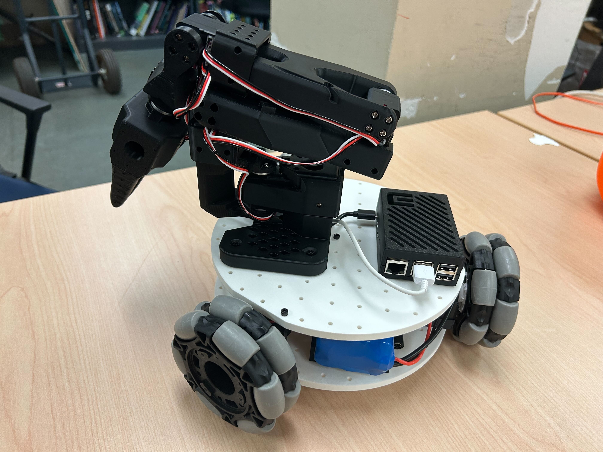

[English](../en/assembly-guide.md) | 简体中文 | [繁體中文](../zh-hant/assembly-guide.md) | [Deutsch](../de/assembly-guide.md) | [Español](../es/assembly-guide.md) | [Français](../fr/assembly-guide.md) | [Italiano](../it/assembly-guide.md) | [日本語](../ja/assembly-guide.md) | [한국어](../ko/assembly-guide.md) | [Português (BR)](../pt-br/assembly-guide.md) | [Português (PT)](../pt-pt/assembly-guide.md)

<title>Lekiwi移动机器人组装教程</title>

[*在Fusion360 在线 CAD*](https://a360.co/4k1P8yO)*中可以可视化精确的组件位置。*

[URDF文件](https://gitcode.com/gh_mirrors/le/LeKiwi/tree/main)

在线URDF预览https://urdf.d-robotics.cc/

# 一、组装轮子模块（每台机器人3个）

1.使用 12 个 **M2x6** 自攻螺钉将驱动电机固定到电机支架上。（舵机盒自带）

<grid>
<column width-ratio="0.418383">

</column>
<column width-ratio="0.581617">

</column>
</grid>

2.使用 12 个 **M3x16** 机螺钉和 12个 **M3螺母** 用 驱动电机支架 将 舵机 固定到底板上。

3.将82mm全向轮的机螺钉和螺母拆下

4.使用 m3\*6螺丝 将 舵盘 固定到舵机上

5.安装 4个防松螺母到 联轴器里，先使用 4个 m3\*6螺丝 将 联轴器 固定到 舵盘 上

<grid>
<column width-ratio="0.476318">

</column>
<column width-ratio="0.523682">

</column>
</grid>

6.使用 m3\*25机螺钉和防松螺母 将 82mm全向轮 固定在 联轴器 上

三个轮子全部安装到底板上后：

<grid>
<column width-ratio="0.501676">

</column>
<column width-ratio="0.498324">

</column>
</grid>

# 二、底板组件

1.将 2个M3螺母 插入舵机驱动板和电池安装座的孔中。用 4颗M3x12六角螺丝 将两者固定到底板上。

<grid>
<column width-ratio="0.478600">

</column>
<column width-ratio="0.521400">

</column>
</grid>

2.用 2个M3\*12六角螺丝 和 2个M3螺母 安装 舵机驱动板 并连接到 3 个舵机上。

移动电源 电缆连接

- **电源输入**直接连接到电源

<grid>
<column width-ratio="0.500000">

</column>
<column width-ratio="0.500000">

</column>
</grid>

- **USB-C** 接口为树莓派提供 5V 电源
- 如果使用 **12V 机械臂**，直接用 **DC 电源分配器** 为 **舵机电机板**供电

<grid>
<column width-ratio="0.500000">

</column>
<column width-ratio="0.500000">

</column>
</grid>

电缆可按照下图所示连接：

# 三、顶板组装

1.将 树莓派5 放入树莓派外壳底部，然后扣上外壳顶部。

2.使用 两颗 M3x16 六角螺丝 和 两颗 M3螺母 将树莓派固定到顶部底板上，并使用四颗 M4x25 机螺钉和 四颗M4螺母 安装 SO-101 机械臂底座。

# 四、

1.将舵机驱动板 USB-C 转 USB-A 线、5V USB-C 电源线和 舵机线 穿过顶底板上的孔。

2.使用 8 个 m3x16 机螺钉和 4个m3螺母将 顶底板 安装到电机支架上。

# 五、安装摄像头

*注意：我们设计的支架是专为我们选择的相机设计的。对于不同的相机模块，可能需要进行修改。*

## （选项 1）安装前视摄像头

①使用 4个 m2\*5\*5垫片螺丝固定摄像头模组

②使用 2个 m3\*12机螺钉 和 2颗m3螺母 安装前视摄像头支架到底板上

<grid>
<column width-ratio="0.500000">

</column>
<column width-ratio="0.500000">

</column>
</grid>

## （选项 2）安装臂载摄像头

使用 4个 m2\*5\*5垫片螺丝固定摄像头模组

该支架支持孔间距24\*25mm或者28\*28mm的摄像头

# 六、插上电源并接线

将直流圆筒形插头适配器插入 **舵机驱动板** 上；

将 5V USB-C 连接器插入**树莓派5**，即可为电子设备供电；

舵机驱动板和摄像头的 USB 数据线 可以直接插入树莓派。

