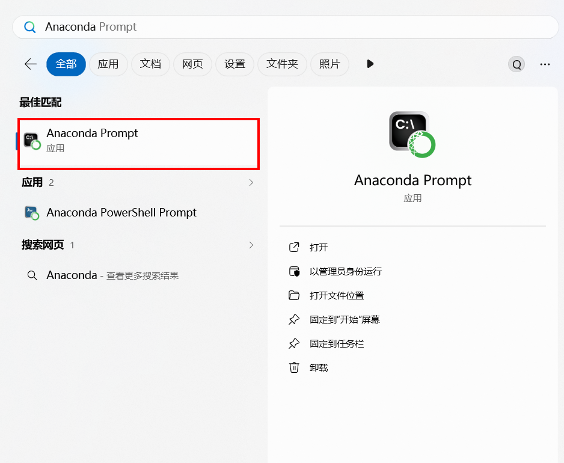
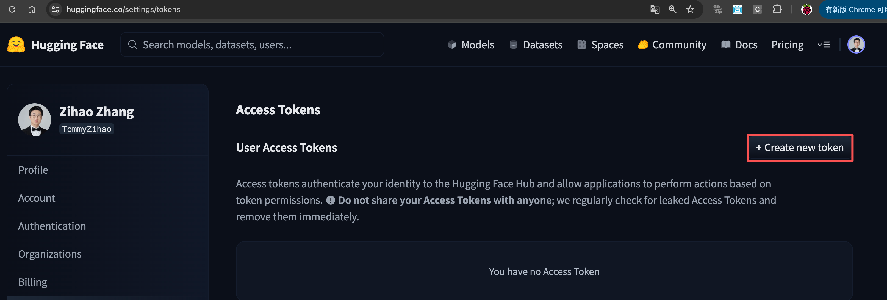
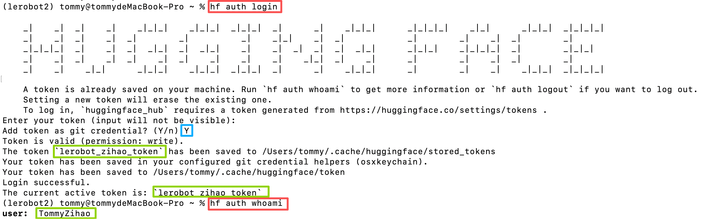
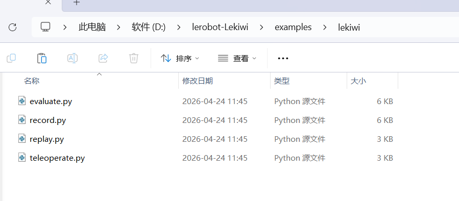
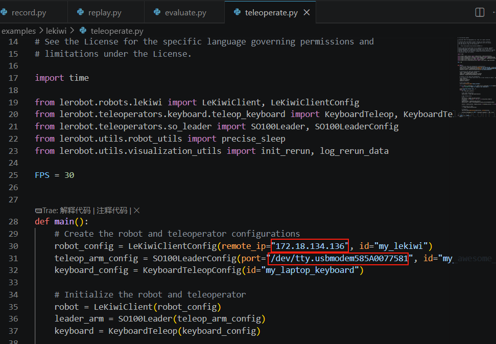
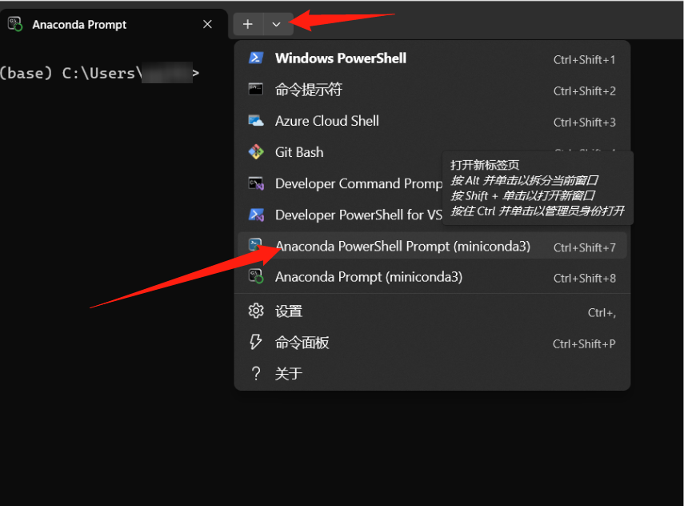

[English](../en/usage-guide.md) | 简体中文 | [繁體中文](../zh-hant/usage-guide.md) | [Deutsch](../de/usage-guide.md) | [Español](../es/usage-guide.md) | [Français](../fr/usage-guide.md) | [Italiano](../it/usage-guide.md) | [日本語](../ja/usage-guide.md) | [한국어](../ko/usage-guide.md) | [Português (BR)](../pt-br/usage-guide.md) | [Português (PT)](../pt-pt/usage-guide.md)

<title>Lekiwi移动机器人使用教程</title>

<callout emoji="💡">
黑色主动臂使用5V6A电源适配器，白色从动臂使用12V5A电源适配器
</callout>

<figure view-type="Card">[附件 / Attachment: lerobot.zip](../en/images/lerobot.zip)</figure>

本教程仓库代码保持为2026年10月1日之前的Lerobot经过测试的稳定版本，目前Huggingface对Lerobot进行了非常庞大的升级，增加了非常多的新功能，如果需要体验最新的教程请跟随[官方文档进行操作](https://huggingface.co/docs/lerobot/lekiwi)。


[Lekiwi](https://github.com/SIGRobotics-UIUC/LeKiwi) 是由 [SIGRobotics-UIUC](https://github.com/SIGRobotics-UIUC) 发起的一个完全开源的机器人小车项目。它包含详细的 3D 打印文件和操作指南，设计上与 [LeRobot](https://github.com/huggingface/lerobot/tree/main) 模仿学习框架兼容。它支持 SO101 机器人手臂，从而实现完整的模仿学习流程。

[*在Fusion360 在线 CAD*](https://a360.co/4k1P8yO)*中可以可视化精确的组件位置。*

[URDF文件](https://gitcode.com/gh_mirrors/le/LeKiwi/tree/main)

在线URDF预览https://urdf.d-robotics.cc/


## 主要特点

1. **开源且低成本**： [Lekiwi](https://github.com/SIGRobotics-UIUC/LeKiwi) 提供了一种开源、低成本的机器人小车解决方案。
2. **与 LeRobot 集成**： 专为与 [LeRobot 平台](https://github.com/huggingface/lerobot) 集成而设计。
3. **丰富的学习资源**： 提供全面的开源学习资源，包括组装和校准指南，以及测试、数据收集、训练和部署的教程，帮助用户快速入门并开发机器人应用。
4. **兼容 Nvidia**： 可与 reComputer Mini J4012 Orin NX 16 GB 搭配使用。
5. **多场景应用**： 适用于教育、科学研究、自动化生产和机器人领域，帮助用户在各种复杂任务中实现高效且精准的机器人操作。

<callout emoji="⚠️">
JUXI 仅对硬件本身的质量负责。教程严格按照官方文档更新。如果您遇到实在无法解决的软件问题或环境依赖问题，请及时向 [LeRobot 平台](https://github.com/huggingface/lerobot) 或 [LeRobot Discord 频道](https://discord.gg/8TnwDdjFGU) 报告问题。
</callout>

<callout emoji="🔥">
**注意**
- Lekiwi 底盘中的所有舵机需要 12V 电源供电。对于使用 5V 机器人手臂的用户，我们提供了 12V 转 5V 降压转换模块。请注意，您需要自行进行电路修改。
- 12V 电源 - 如果需要，您可以在结账时选择此选项。如果您已经拥有 12V 电源，只需将电源输出接口转换为 5521 DC 插头即可。
- 树莓派控制器和摄像头 - 这些需要通过订单界面单独购买。
</callout>

## 物料清单 (BOM)

<sheet sheet-id="MNu6oT" token="Z4UGs2S65hWsWBtzlT8c80yCnqc"></sheet>

## 初始系统环境

**对于 Ubuntu x86:**

- Ubuntu 22.04
- CUDA 12+
- Python 3.10
- Torch 2.6

**对于 Jetson Orin:**

- Jetson JetPack 6.0
- Python 3.10
- Torch 2.3+

**对于树莓派:**

- 树莓派5 4G\~16G

### 设置 SSH

设置好树莓派后，您应该启用并配置[SSH](https://www.raspberrypi.com/news/coding-on-raspberry-pi-remotely-with-visual-studio-code/)（安全外壳协议），这样您就可以从笔记本电脑登录到树莓派，而无需在树莓派上连接屏幕、键盘和鼠标。您可以[在这里](https://www.raspberrypi.com/documentation/computers/remote-access.html#ssh)找到一个很棒的教程。您可以通过命令提示符 (cmd) 登录到树莓派，或者如果您使用 VSCode，则可以使用[此](https://marketplace.visualstudio.com/items?itemName=ms-vscode-remote.remote-ssh)扩展程序。

## 3D打印指南

### 部件

我们提供以下3D打印部件的可打印STL文件。这些部件可以使用通用PLA耗材在消费级FDM打印机上打印。我们在Bambu Lab P1S打印机上进行了测试。对于所有组件，我们只需加载到bambuslicer中，自动旋转和排列，启用任何推荐的支撑，然后打印。

<sheet sheet-id="jIOIj0" token="Z4UGs2S65hWsWBtzlT8c80yCnqc"></sheet>

### 打印参数

提供的STL文件可以在许多FDM打印机上直接打印。以下是测试和建议的设置，其他设置也可能有效。

- 材料：PLA+
- 喷嘴直径和精度：0.2mm喷嘴直径，层高0.2mm
- 填充密度：15%
- 打印速度：150 mm/s
- 如果需要，将G代码（切片文件）上传到打印机并打印

# A. 在树莓派上安装 LeRobot

在您的 Raspberry Pi 上：

### 1. [安装 Miniconda](https://docs.anaconda.com/miniconda/install/#quick-command-line-install):

```Python
mkdir -p ~/miniconda3
wget https://repo.anaconda.com/miniconda/Miniconda3-latest-Linux-aarch64.sh -O ~/miniconda3/miniconda.sh
bash ~/miniconda3/miniconda.sh -b -u -p ~/miniconda3
rm ~/miniconda3/miniconda.sh
```

### 2. 重启 Shell

在您的 Shell 中复制粘贴以下命令：`source ~/.bashrc` 或对于 Mac 用户：`source ~/.bash_profile` 或 `source ~/.zshrc`（如果您使用的是 zshell）

### 3. 为 LeRobot 创建并激活一个新的 Conda 环境

```Python
conda create -y -n lerobot python=3.10
```

然后激活您的 Conda 环境（每次打开 Shell 使用 LeRobot 时都需要执行此操作！）：

```Bash
conda activate lerobot
```

### 4. 克隆 LeRobot：

```Bash
git clone https://github.com/huggingface/lerobot.git ~/lerobot
```

### 5. 在您的环境中安装 ffmpeg：

使用 `miniconda` 时，在您的环境中安装 `ffmpeg`：

```PowerShell
conda install ffmpeg -c conda-forge
```

<callout emoji="💡">
这通常会为你的平台安装使用 libsvtav1 编码器编译的 ffmpeg 7.X。如果不支持 libsvtav1（可以通过 `ffmpeg -encoders` 查看支持的编码器），你可以：
【适用于所有平台】显式安装 ffmpeg 7.X：
`conda install ffmpeg=7.1.1 -c conda-forge`
【仅限 Linux】安装 ffmpeg 的构建依赖并从源码编译支持 libsvtav1 的 ffmpeg，并确保使用的 ffmpeg 可执行文件是正确的，可以通过 `which ffmpeg` 确认。
如果你遇到以下报错，也可以使用上述命令解决。
</callout>


### 6. 安装带有 feetech 电机依赖的 LeRobot：

```Bash
cd ~/lerobot && pip install --no-binary=av -e ".[feetech]"
pip install -e ".[lekiwi]"
```

### 7. 设置连接时间

`lerobot\src\lerobot\robots\lekiwi`目录下找到config_lekiwi.py

 connection_time_s: int = 7200 # 也就是2小时


# B. 在笔记本电脑上安装 LeRobot

如果您已经在笔记本电脑上安装了 LeRobot，可以跳过此步骤，否则请按照我们在 Raspberry Pi 上的**相同步骤**进行操作。

> [!提示] 我们会频繁使用命令提示符 (cmd)。如果您对使用 cmd 不熟悉，或者想复习命令行的使用，可以参考这里：[命令行速成课程](https://developer.mozilla.org/en-US/docs/Learn_web_development/Getting_started/Environment_setup/Command_line)

在您的电脑上：

### 1. [安装 Miniconda](https://docs.anaconda.com/miniconda/install/#quick-command-line-install):

anaconda.com/download/success

或者直接点这个链接下载安装包

https://repo.anaconda.com/miniconda/Miniconda3-latest-Windows-x86_64.exe

<grid>
<column width-ratio="0.500000">

</column>
<column width-ratio="0.500000">

</column>
</grid>

## conda换源

```Shell
# 先清空原有源配置（避免冲突）
conda config --remove-key channels

# 将 conda 的默认源和常用第三方源替换为清华镜像
# 添加默认包源（main/r/msys2）
conda config --add channels https://mirrors.tuna.tsinghua.edu.cn/anaconda/pkgs/main/
conda config --add channels https://mirrors.tuna.tsinghua.edu.cn/anaconda/pkgs/r/
conda config --add channels https://mirrors.tuna.tsinghua.edu.cn/anaconda/pkgs/msys2/

# 添加常用第三方源
conda config --add channels https://mirrors.tuna.tsinghua.edu.cn/anaconda/cloud/conda-forge/
conda config --add channels https://mirrors.tuna.tsinghua.edu.cn/anaconda/cloud/msys2/
conda config --add channels https://mirrors.tuna.tsinghua.edu.cn/anaconda/cloud/bioconda/
conda config --add channels https://mirrors.tuna.tsinghua.edu.cn/anaconda/cloud/menpo/
conda config --add channels https://mirrors.tuna.tsinghua.edu.cn/anaconda/cloud/pytorch/

# 开启显示下载源，安装包时会显示具体的下载地址
conda config --set show_channel_urls yes

# 清除索引缓存，使新源生效
conda clean -i

# 查看当前配置（验证源是否添加成功）
conda config --show-sources
```

### 2. 重启 Shell

在您的 Shell 中复制粘贴以下命令：`source ~/.bashrc` 或对于 Mac 用户：`source ~/.bash_profile` 或 `source ~/.zshrc`（如果您使用的是 zshell）



### 3. 为 LeRobot 创建并激活一个新的 Conda 环境

```Bash
conda create -y -n lerobot python=3.10
```

然后激活您的 Conda 环境（每次打开 Shell 使用 LeRobot 时都需要执行此操作！）：

```Bash
conda activate lerobot
```

### 4. 克隆 LeRobot：

```Bash
git clone https://github.com/huggingface/lerobot.git ~/lerobot
```

### 5. 在您的环境中安装 ffmpeg：

使用 `miniconda` 时，在您的环境中安装 `ffmpeg`：

```PowerShell
conda install ffmpeg -c conda-forge
```

<callout emoji="💡">
这通常会为你的平台安装使用 libsvtav1 编码器编译的 ffmpeg 7.X。如果不支持 libsvtav1（可以通过 `ffmpeg -encoders` 查看支持的编码器），你可以：
【适用于所有平台】显式安装 ffmpeg 7.X：
`conda install ffmpeg=7.1.1 -c conda-forge`
【仅限 Linux】安装 ffmpeg 的构建依赖并从源码编译支持 libsvtav1 的 ffmpeg，并确保使用的 ffmpeg 可执行文件是正确的，可以通过 `which ffmpeg` 确认。
如果你遇到以下报错，也可以使用上述命令解决。
</callout>


### 6. 安装带有 feetech 电机依赖的 LeRobot：

```Bash
cd ~/lerobot && pip install --no-binary=av -e ".[feetech]"
pip install -e ".[lekiwi]"
```

# C. 配置电机

<grid>
<column width-ratio="0.473717">

</column>
<column width-ratio="0.526283">

</column>
</grid>

### **1.查找与机械臂相关联的 USB 端口**

要找到单个电机的正确端口，请运行以下实用脚本两次：

```Bash
lerobot-find-port
```

示例输出（例如，在 Mac 上为 `/dev/tty.usbmodem575E0031751`，或在 Linux 上可能为 `/dev/ttyACM0`）：

示例输出（例如，在 Mac 上为 `/dev/tty.usbmodem575E0032081`，或在 Linux 上可能为 `/dev/ttyACM1`）：

故障排除：在 Linux 上，您可能需要通过以下命令授予 USB 端口访问权限：

```Bash
sudo chmod 666 /dev/ttyACM0
sudo chmod 666 /dev/ttyACM1
```

### **2.配置您的电机（成品可跳过该步骤）**

依次插入您的底盘的每一个电机并运行以下脚本，他会先初始化机械臂（ID 6..1）的舵机，然后再初始化底盘舵机，将其 ID 设置为（ID 9..7）的舵机，如果你已经校准过机械臂，可以连续按回车不断覆盖和跳过：

```Bash
lerobot-setup-motors \
    --robot.type=lekiwi \
    --robot.port=/dev/tty.usbmodem58760431551 # <- paste here the port found at previous step
```


### 3.设置HuggingFace国内镜像

- Ubuntu

```Shell
sudo nano ~/.bashrc

# 在文件末尾加入
export HF_ENDPOINT=https://hf-mirror.com
```

```Shell
source ~/.bashrc
echo $HF_ENDPOINT

# 输出
# https://hf-mirror.com
```

- Mac

```Shell
sudo nano ~/.zshrc

# 在文件末尾加入
export HF_ENDPOINT=https://hf-mirror.com
```

```Shell
source ~/.zshrc

# 输出
# https://hf-mirror.com
```

#### ①创建Token

https://huggingface.co/settings/tokens




#### ②记录Token


#### ③绑定Token

```Shell
hf auth login

hf auth whoami
```



#### ④创建Dataset Repo

**记下Owner和Dateset name，即后续需要的<hf_username>和<dateset_repo_id>**

<grid>
<column width-ratio="0.480604">

</column>
<column width-ratio="0.519396">

</column>
</grid>


### 4.更新配置！！！

LeKiwi LeRobot 和笔记本电脑上的配置文件应保持一致。首先，我们需要找到移动机械臂的树莓派的 **IP 地址**。这与用于 SSH 的 IP 地址相同。我们还需要找到笔记本电脑上主动臂舵机驱动板的 **USB 端口**以及 **LeKiwi 上舵机驱动板的端口**。可以通过以下脚本找到这些端口。

在 Linux 上，您可能需要通过运行以下命令来授予 USB 端口的访问权限：

```Bash
sudo chmod 666 /dev/ttyACM0
sudo chmod 666 /dev/ttyACM1
```

重要提示：现在您已经获得了主动臂的端口以及Lekiwi的机械臂的 IP 地址，请在网络配置中更新 **ip**，在主动臂配置中更新 **port**，并在 LeKiwi 配置中更新 **port，remote_ip**。

在example\lekiwi目录下修改这四个文件



#### ①修改teleoperate.py

remote_ip:树莓派的ip地址

port:主动臂连接到电脑或者linux时的端口号



#### ②修改record.py

HF_REPO_ID：[huggingface的用户名和数据集名称](https://juxitech.feishu.cn/wiki/A2orwQ9xzidMCjk10SVcAAWVnhd?fromScene=spaceOverview#share-TYrIdHmPPobd1mx9xB7c75WEn0d)

remote_ip:树莓派的ip地址

port:主动臂连接到电脑或者linux时的端口号


#### ③修改replay.py

remote_ip:树莓派的ip地址

<hf_username>/<dataset_repo_id>，即[huggingface的用户名和数据集名称](https://juxitech.feishu.cn/wiki/A2orwQ9xzidMCjk10SVcAAWVnhd?fromScene=spaceOverview#share-TYrIdHmPPobd1mx9xB7c75WEn0d)

![图片展示的是Leki addCriterionekiwi移动机器人使用教程中修改replay.py代码的界面。代码中，第29行的robot_config参数被修改为包含remote_ip和id，其中remote_ip为“172.18.134.136”，id为“lekiwi”；第36行的dataset参数被修改为包含<hf_username>/<dataset_repo_id>，即\[huggingface的用户名和数据集名称\]。这些修改与 addCriterionekiwi移动机器人使用教程中修改re addCriterionekiwi移动机器人使用教程中修改replay.py代码的界面。代码中，第29行的robot_config参数被修改为包含remote_ip和id，其中remote_ip为“](../en/images/fix-01.png)

# D.校准

现在我们需要校准主动臂和从动臂。全向轮的舵机无需校准。

### 校准从动臂（安装在Lekiwi底座上）

在您的电脑上运行以下命令以校准主动臂。注意：这里显示的图片是 SO101 型号的示例。

```Bash
lerobot-calibrate \
    --teleop.type=so100_leader \
    --teleop.port=/dev/tty.usbmodem58760431551 \ #修改为找到的端口号
    --teleop.id=my_awesome_leader_arm
```

现在在您的 Raspberry Pi 上运行以下命令以校准 LeKiwi 上的从动臂。忽略它当前在桌上的位置——正常校准应在安装到Lekiwi底盘上时进行。

```Bash
lerobot-calibrate \
    --robot.type=lekiwi \
    --robot.id=my_awesome_kiwi
```

我们统一了大多数机器人的标定方法。首先，我们需要将机器人移动到每个关节都处于其**可活动范围中间**的位置，然后按下按钮。其次，我们将所有关节在其**完整的可活动范围内**移动一遍。您可以[在这里](https://huggingface.co/docs/lerobot/en/so101#calibration-video)`Enter`找到SO101的相同标定过程视频作为参考。

# E. 远程操作

打开新的Anaconda Prompt



> 如果您使用的是 Mac，可能需要授予“终端”访问键盘进行远程操作的权限。请前往“系统偏好设置”>“安全性与隐私”>“输入监视”，然后勾选“终端”复选框。

要进行远程操作，请通过 SSH 登录到您的 Raspberry Pi，并运行以下命令激活环境 `conda activate lerobot`，然后运行以下脚本：

```Bash
python -m lerobot.robots.lekiwi.lekiwi_host --robot.id=my_awesome_kiwi
```


接着，在您的笔记本电脑上，也运行以下命令激活环境 `conda activate lerobot`，然后运行以下脚本：

```Bash
python examples/lekiwi/teleoperate.py
```

你的笔记本电脑屏幕上应该会显示类似这样的界面：`[INFO] Connected to remote robot at tcp://172.17.133.91:5555 and video stream at tcp://172.17.133.91:5556.`现在你可以移动控制臂，并使用键盘上的 (W, A, S, D) 键控制机器人前进、左转、后退、右转。使用 (Z, X) 键控制机器人左转或右转。使用 (R, F) 键可以增加或减少移动机器人的速度。共有三种速度模式，请参见下表：

<sheet sheet-id="vJeIqV" token="Z4UGs2S65hWsWBtzlT8c80yCnqc"></sheet>

<sheet sheet-id="iR6oYP" token="Z4UGs2S65hWsWBtzlT8c80yCnqc"></sheet>

<callout emoji="💡">
如果您使用不同的键盘，您可以在[`LeKiwiClientConfig`](https://github.com/huggingface/lerobot/blob/main/src/lerobot/robots/lekiwi/config_lekiwi.py)中更改每个命令的按键设置。
</callout>

## 通信故障排查

如果您在连接移动机器人 SO101 时遇到问题，请按照以下步骤诊断并解决问题。

### 1.验证 IP 地址配置

确保配置文件中设置了正确的 Raspberry Pi IP 地址。要检查 Raspberry Pi 的 IP 地址，请运行以下命令（在 Pi 的命令行中）：

```Bash
hostname -I
```

### 2.检查笔记本电脑/PC 是否能访问 Pi

尝试从笔记本电脑 ping Raspberry Pi：

```Bash
ping <your_pi_ip_address>
```

如果 ping 失败：

- 确保 Pi 已开机并连接到同一网络。
- 检查 Pi 上是否启用了 SSH。

### 3.尝试 SSH 连接

如果无法通过 SSH 登录到 Pi，可能是连接不正确。请使用以下命令：

```Bash
ssh <your_pi_user_name>@<your_pi_ip_address>
```

例如`ssh pi@192.168.0.106`

如果出现连接错误：

- 确保 Pi 上启用了 SSH，可以运行以下命令：

```Bash
sudo raspi-config
```

- 然后导航到：**Interfacing Options -> SSH** 并启用它。

### 4.配置文件一致性！！！

确保笔记本电脑/PC 和 Raspberry Pi 上的配置文件完全一致。

# F. 记录数据集

在熟悉远程操作后，您可以使用 LeKiwi 记录您的第一个数据集。

要在 LeKiwi 上启动程序，请通过 SSH 连接到您的 Raspberry Pi，并运行以下命令以激活环境并启动脚本：

```Bash
conda activate lerobot

python -m lerobot.robots.lekiwi.lekiwi_host --robot.id=my_awesome_kiwi
```

如果您希望使用 Hugging Face hub 功能上传数据集，并且之前尚未登录，请确保使用写入权限的令牌登录，该令牌可以从 [Hugging Face 设置](https://huggingface.co/settings/tokens) 中生成：

```Bash
hf auth login
```

将您的 Hugging Face 仓库名称存储在变量中以运行以下命令：

```Bash
hf auth whoami
```

然后在您的笔记本电脑上运行以下命令以记录 2 个回合并将数据集上传到 hub：

```Bash
python examples/lekiwi/record.py
```

# G. 可视化数据集

如果您上传了数据集，可以通过 [在线可视化您的数据集](https://huggingface.co/spaces/lerobot/visualize_dataset)，复制并粘贴以下命令生成的仓库 ID：

```Bash
echo ${HF_USER}/my_lekiwi_dataset
```

如果您没有上传数据集，也可以在本地进行可视化（浏览器窗口可以通过 `http://127.0.0.1:9090` 打开可视化工具）：

```Bash
python lerobot/scripts/visualize_dataset_html.py \
  --repo-id ${HF_USER}/lekiwi_test \
  --local-files-only 1
```

### 可视化一个数据集（可跳过，可尝试）

```Bash
echo ${HF_USER}/my_lekiwi_dataset
```

如果您上传了数据集，您也可以在本地通过以下命令进行可视化：

```Python
lerobot-dataset-viz \
  --repo-id ${HF_USER}/my_lekiwi_dataset \
```

如果您没有上传数据集，您也可以通过以下命令在本地进行可视化：

```Python
lerobot-dataset-viz \
  --repo-id juxi/my_lekiwi_dataset \
```

这里，`juxi` 是数据收集时自定义的 `repo_id` 名称。


#### 数据收集技巧

一旦您熟悉了数据记录，就可以创建更大的数据集用于训练。一个不错的入门任务是抓取不同位置的物体并将其放入容器中。我们建议至少录制 50 个片段，每个位置 10 个片段。保持摄像头位置固定，并在整个录制过程中保持一致的抓取动作。同时，确保您操作的物体在摄像头画面中清晰可见。一个简单的判断标准是，您应该能够仅通过观察摄像头画面就完成这项任务。

在接下来的章节中，您将训练您的神经网络。在获得可靠的抓取性能后，您可以开始在数据采集过程中引入更多变化，例如增加抓取位置、采用不同的抓取技术以及改变相机位置。

避免过快地增加过多的变化，因为这可能会影响你的结果。

如果您想深入了解这个重要话题，可以查看我们撰写的关于优秀数据集构成要素的[博客文章。](https://huggingface.co/blog/lerobot-datasets#what-makes-a-good-dataset)

#### 故障排除：

在 Linux 系统中，如果在数据记录过程中左右箭头键和 Esc 键不起作用，请确保已设置`$DISPLAY`环境变量。请参阅[pynput 的限制](https://pynput.readthedocs.io/en/latest/limitations.html#linux)

# H. 回放一个回合

现在尝试在您的机器人上回放第一个回合：

```Bash
python examples/lekiwi/replay.py
```

恭喜🎉，你的机器人已经准备好自主学习任务了。请按照本教程的训练部分开始训练它：[真实世界机器人入门](https://huggingface.co/docs/lerobot/il_robots)

# I. 评估你的策略

确保更改remote_ip, port, HF_MODEL_ID

### 修改evaluate.py

HF_MODEL_ID="<hf_username>/<model_repo_id>" 修改为训练上传到huggingface上的数据集名称（如果上传到huggingface的话）或 训练后将模型导出到本地的目录

HF_DATASET_ID="<hf_username>/<eval_dataset_id>" 改为自己创建的用户名和 eval_数据集名称

remote_ip：树莓派ip地址


然后运行以下命令：

```Bash
python examples/lekiwi/evaluate.py
```

1. 数据集的名称以 `eval` 开头，以反映你正在运行推理（例如 `${HF_USER}/eval_act_lekiwi_test`）。
2. 如果评估阶段遇到`File exists: 'home/xxxx/.cache/huggingface/lerobot/xxxxx/juxi/eval_xxxx'`请先删除`eval_`开头的这个文件夹再次运行程序。


仿真训练可参考

https://github.com/Ekumen-OS/lekiwi/tree/main

https://github.com/SIGRobotics-UIUC/LeKiwi-sim


## 帮助 🙋‍

对于硬件问题，请联系客户服务。对于使用问题，请加入 Discord。

[LeRobot 平台](https://github.com/huggingface/lerobot)

[LeRobot Discord 频道](https://discord.gg/8TnwDdjFGU)

#   
  
MAC电脑安装Miniconda

## 加权限


## 安装Miniconda

https://www.anaconda.com/download

## pip换源

```Shell
pip config set global.index-url https://mirrors.aliyun.com/pypi/simple
```

## conda换源

```Shell
# 清空原有 .condarc 配置（可选，避免冲突）
echo "" > ~/.condarc

# 写入清华源配置
cat << EOF > ~/.condarc
channels:
  - defaults
show_channel_urls: true
default_channels:
  - https://mirrors.tuna.tsinghua.edu.cn/anaconda/pkgs/main
  - https://mirrors.tuna.tsinghua.edu.cn/anaconda/pkgs/r
  - https://mirrors.tuna.tsinghua.edu.cn/anaconda/pkgs/msys2
custom_channels:
  conda-forge: https://mirrors.tuna.tsinghua.edu.cn/anaconda/cloud
  msys2: https://mirrors.tuna.tsinghua.edu.cn/anaconda/cloud
  bioconda: https://mirrors.tuna.tsinghua.edu.cn/anaconda/cloud
  menpo: https://mirrors.tuna.tsinghua.edu.cn/anaconda/cloud
  pytorch: https://mirrors.tuna.tsinghua.edu.cn/anaconda/cloud
  pytorch-lts: https://mirrors.tuna.tsinghua.edu.cn/anaconda/cloud
  simpleitk: https://mirrors.tuna.tsinghua.edu.cn/anaconda/cloud
EOF

# 清除缓存使配置生效
conda clean -i
```