[English](../en/assembly-guide.md) | [简体中文](../zh-hans/assembly-guide.md) | 繁體中文 | [Deutsch](../de/assembly-guide.md) | [Español](../es/assembly-guide.md) | [Français](../fr/assembly-guide.md) | [Italiano](../it/assembly-guide.md) | [日本語](../ja/assembly-guide.md) | [한국어](../ko/assembly-guide.md) | [Português (BR)](../pt-br/assembly-guide.md) | [Português (PT)](../pt-pt/assembly-guide.md)

<title>Lekiwi移動機器人組裝教學</title>

[*在Fusion360 線上 CAD*](https://a360.co/4k1P8yO)*中可以視覺化精確的元件位置。*

[URDF檔案](https://gitcode.com/gh_mirrors/le/LeKiwi/tree/main)

線上URDF預覽https://urdf.d-robotics.cc/

# 一、組裝輪子模組（每台機器人3個）

1.使用 12 個 **M2x6** 自攻螺絲將驅動馬達固定到馬達支架上。（伺服馬達盒隨附）

<grid>
<column width-ratio="0.418383">
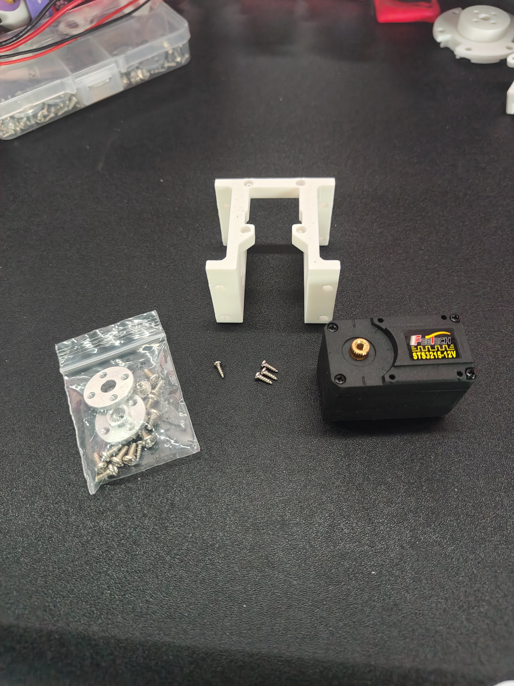
</column>
<column width-ratio="0.581617">
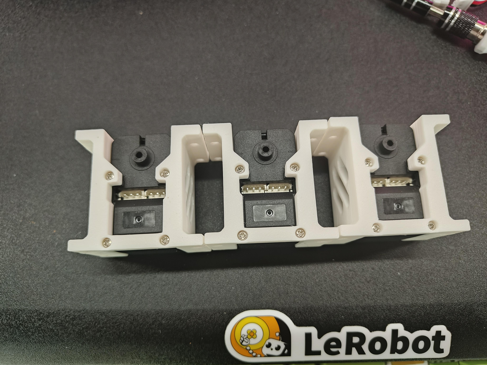
</column>
</grid>

2.使用 12 個 **M3x16** 機械螺絲和 12個 **M3螺母** 用 驅動馬達支架 將 伺服馬達 固定到底板上。

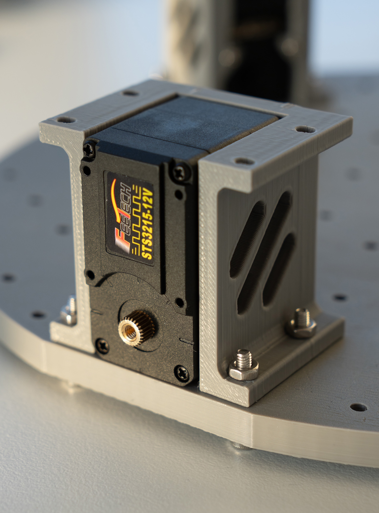

3.將82mm全向輪的機械螺絲和螺母拆下

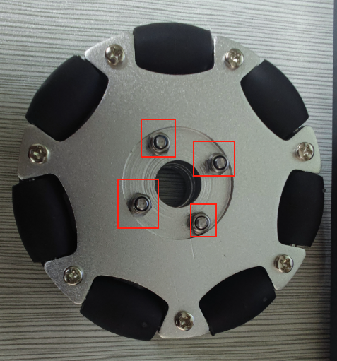

4.使用 m3\*6螺絲 將 舵盤 固定到伺服馬達上

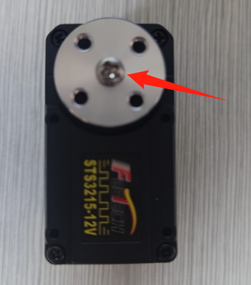

5.安裝 4個防鬆螺母到 聯軸器裡，先使用 4個 m3\*6螺絲 將 聯軸器 固定到 舵盤 上

<grid>
<column width-ratio="0.476318">
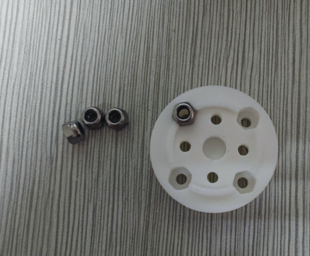
</column>
<column width-ratio="0.523682">
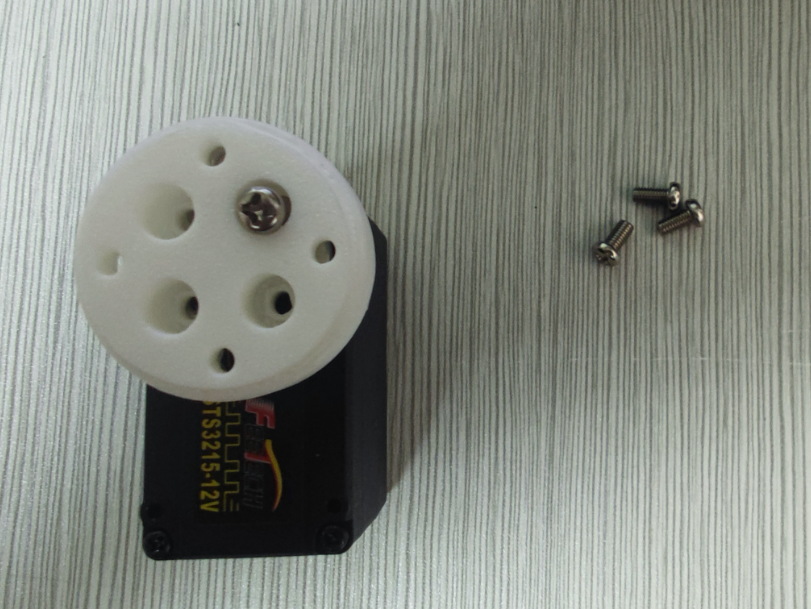
</column>
</grid>

6.使用 m3\*25機械螺絲和防鬆螺母 將 82mm全向輪 固定在 聯軸器 上

三個輪子全部安裝到底板上後：

<grid>
<column width-ratio="0.501676">
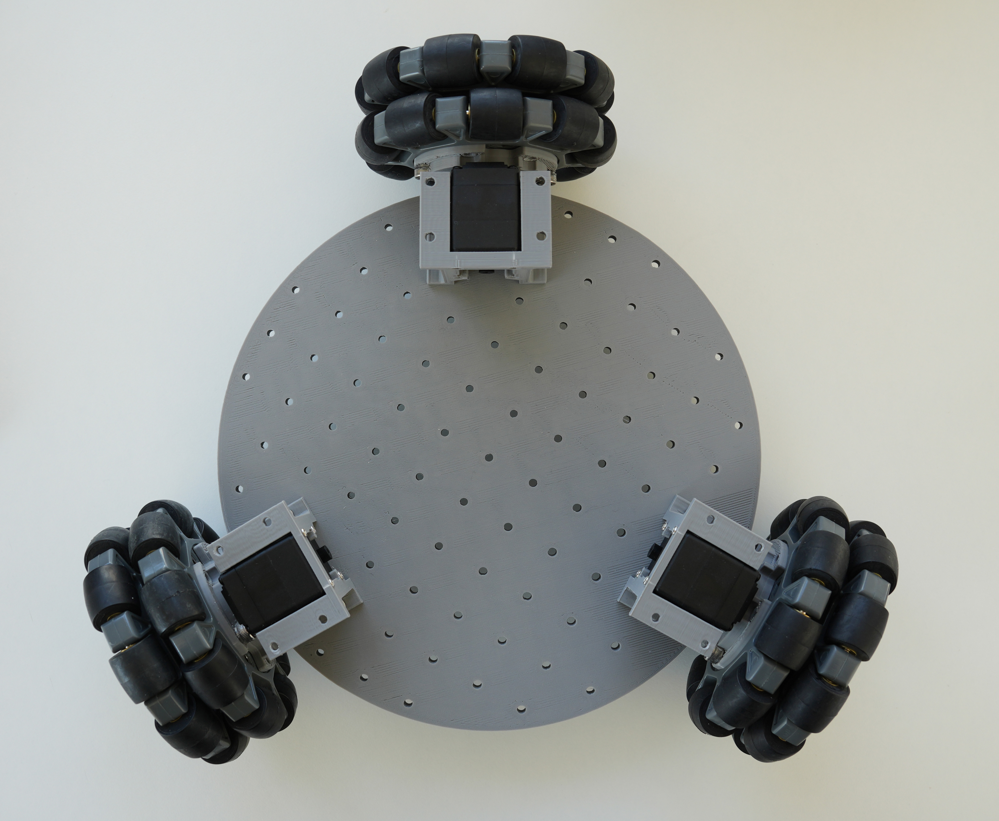
</column>
<column width-ratio="0.498324">
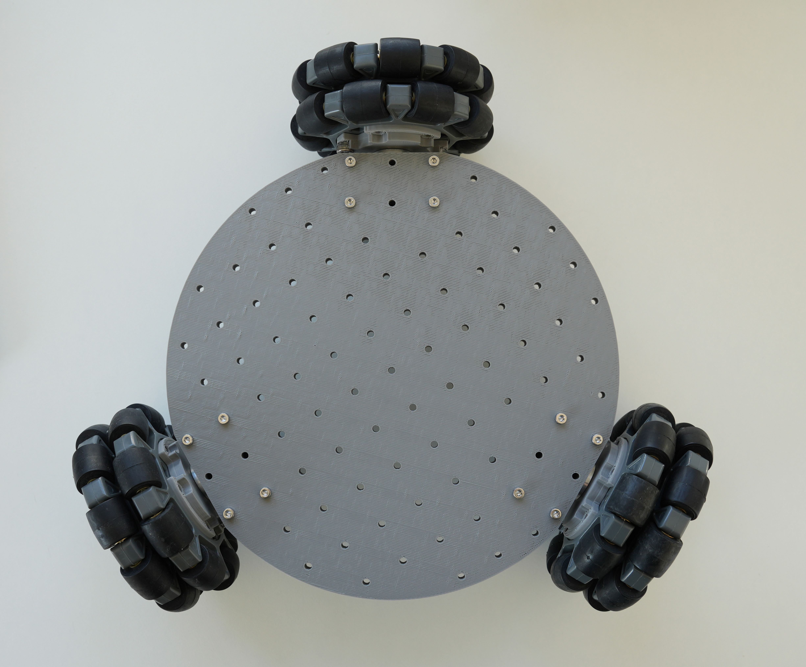
</column>
</grid>

# 二、底板元件

1.將 2個M3螺母 插入伺服馬達驅動板和電池安裝座的孔中。用 4顆M3x12六角螺絲 將兩者固定到底板上。

<grid>
<column width-ratio="0.478600">

</column>
<column width-ratio="0.521400">
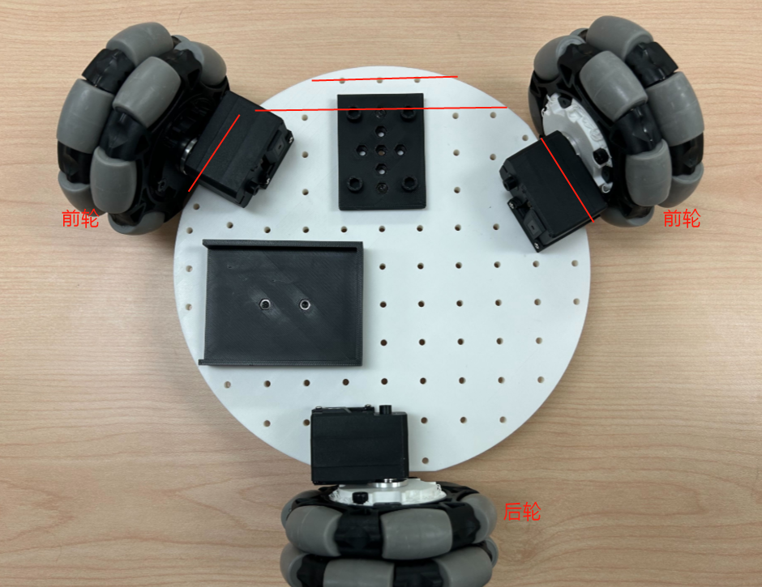
</column>
</grid>

2.用 2個M3\*12六角螺絲 和 2個M3螺母 安裝 伺服馬達驅動板 並連接到 3 個伺服馬達上。

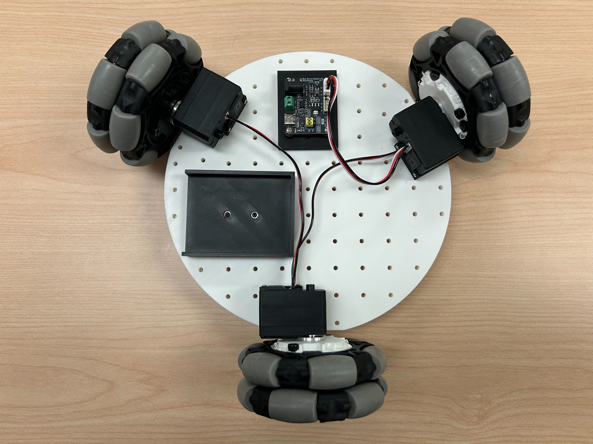

行動電源 電纜連接

- **電源輸入**直接連接到電源

<grid>
<column width-ratio="0.500000">
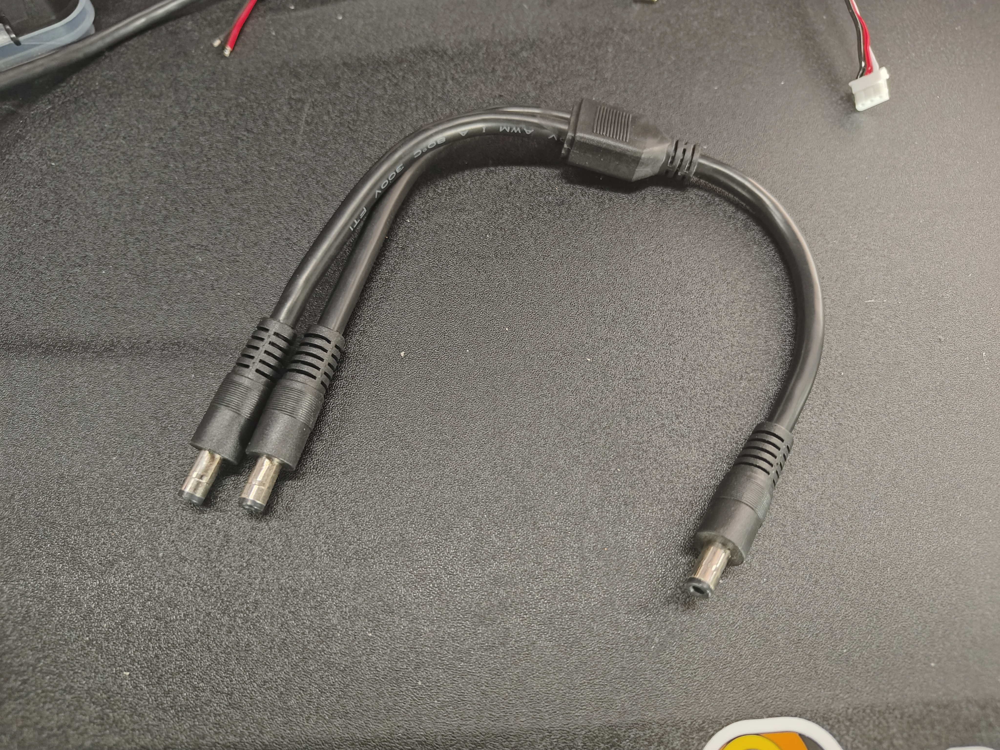
</column>
<column width-ratio="0.500000">
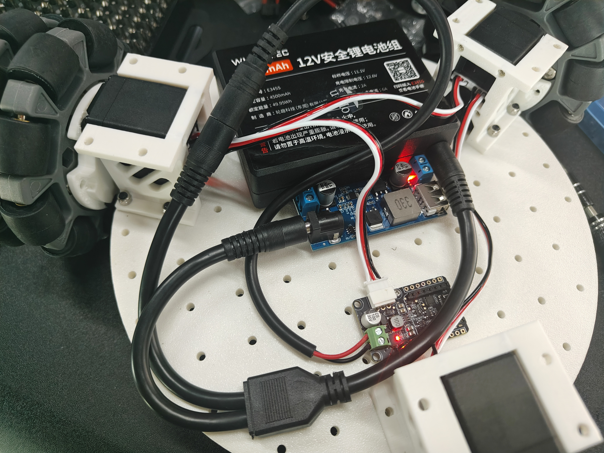
</column>
</grid>

- **USB-C** 接口為樹莓派提供 5V 電源
- 如果使用 **12V 機械手臂**，直接用 **DC 電源分配器** 為 **伺服馬達板**供電

<grid>
<column width-ratio="0.500000">
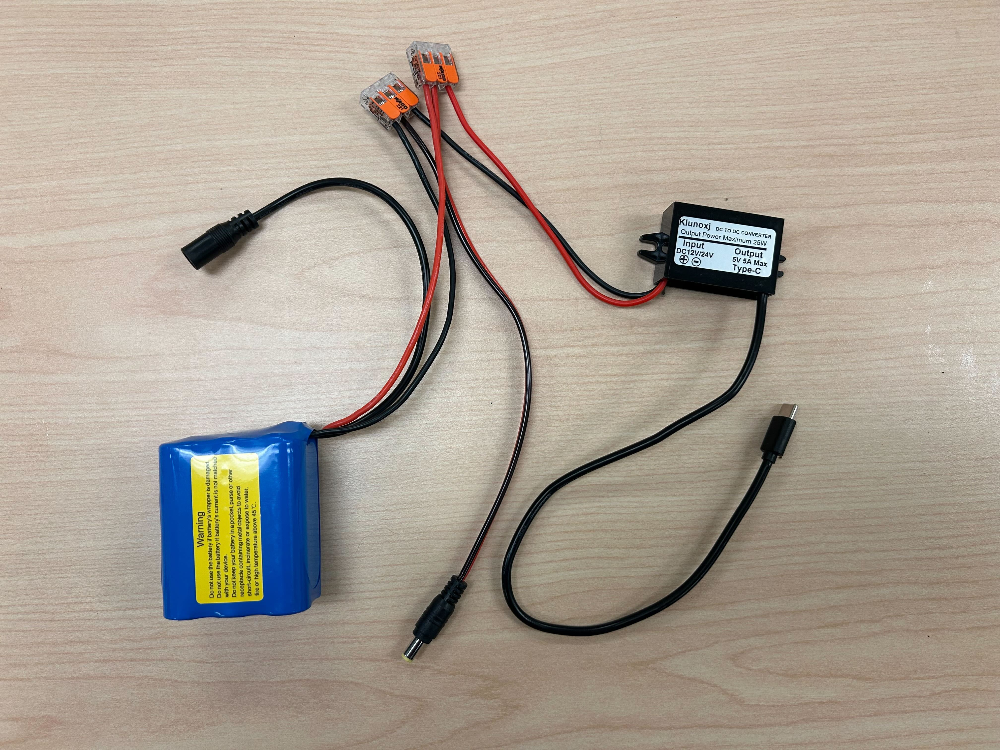
</column>
<column width-ratio="0.500000">
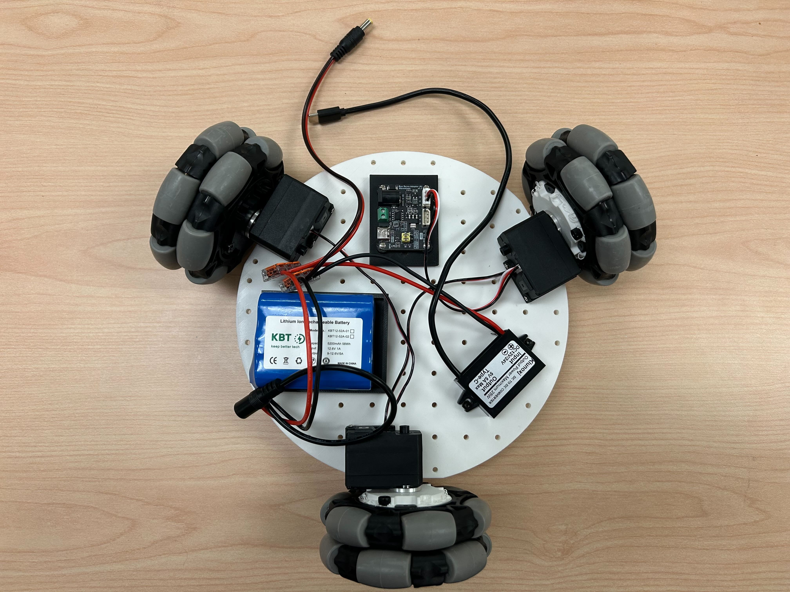
</column>
</grid>

電纜可按照下圖所示連接：

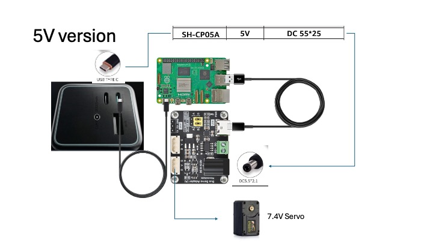

# 三、頂板組裝

1.將 樹莓派5 放入樹莓派外殼底部，然後扣上外殼頂部。

2.使用 兩顆 M3x16 六角螺絲 和 兩顆 M3螺母 將樹莓派固定到頂部底板上，並使用四顆 M4x25 機械螺絲和 四顆M4螺母 安裝 SO-101 機械手臂底座。

# 四、

1.將伺服馬達驅動板 USB-C 轉 USB-A 線、5V USB-C 電源線和 伺服馬達線 穿過頂底板上的孔。

2.使用 8 個 m3x16 機械螺絲和 4個m3螺母將 頂底板 安裝到馬達支架上。

# 五、安裝攝影機

*注意：我們設計的支架是專為我們選擇的相機設計的。對於不同的相機模組，可能需要進行修改。*

## （選項 1）安裝前視攝影機

①使用 4個 m2\*5\*5墊片螺絲固定攝影機模組

②使用 2個 m3\*12機械螺絲 和 2顆m3螺母 安裝前視攝影機支架到底板上

<grid>
<column width-ratio="0.500000">

</column>
<column width-ratio="0.500000">

</column>
</grid>

## （選項 2）安裝臂載攝影機

使用 4個 m2\*5\*5墊片螺絲固定攝影機模組

該支架支援孔間距24\*25mm或者28\*28mm的攝影機

# 六、插上電源並接線

將直流圓筒形插頭適配器插入 **伺服馬達驅動板** 上；

將 5V USB-C 連接器插入**樹莓派5**，即可為電子設備供電；

伺服馬達驅動板和攝影機的 USB 資料線 可以直接插入樹莓派。

